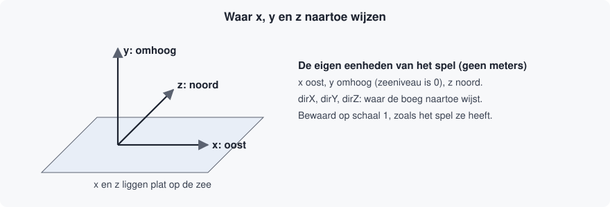

# De tabel {#the-table}

Eén rij per sample of gebeurtenis, in `<match>.parquet`: 31 kolommen
([Kolomlijst](../columns.md), gegenereerd uit de code).

| Kolom | Wat |
|---|---|
| `match`, `map` | het id van het gevecht; de kaart (`spaces/99_testmap` op de afbeeldingen) |
| `time` | seconden sinds het opnemen begon (het aftellen zit erin) |
| `battleTime` | seconden sinds het gevecht begon; negatief tijdens het aftellen |
| `event` | wat de rij is (hieronder) |
| `player`, `team`, `own` | de naam van de speler; `ally` of `enemy` van de opnemende speler; `1` op de rijen van de opnemende speler |
| `vehicle`, `type` | het schip van de opnemende speler bij naam (`PASB018-Iowa-1944`), de andere bij het schipnummer van het spel (`4253956080`), tenzij `--ship-names` ze benoemt; `battleship`, `cruiser`, `destroyer`, `aircraft carrier`, `submarine` waar de naam het zegt, anders `ship` |
| `x`, `y`, `z` | de wereldeenheden van het spel: x oost, y omhoog (zeeniveau 0), z noord |
| `dirX`, `dirY`, `dirZ` | waar de boeg naartoe wijst, een eenheidsvector in hetzelfde stelsel (`dirY` 0: alleen heading); bij een granaat of torpedo de richting waarin het ging |
| `other`, `reason` | het andere schip van een gebeurtenis (killer, slachtoffer, aanvaller); het oorzaaknummer van het spel voor een zinking (niet benoemd), het treffertype voor een inslag, het kanaal voor chat |
| `value`, `health` | het getal van de gebeurtenis (schade, snelheid van een granaat of torpedo in wereldeenheden per seconde); de gezondheid van het schip na een treffer |
| `text` | een chatregel |
| `shot`, `params` | het id van een salvo; het type van de granaat of torpedo, als het parameternummer van het spel |
| `entity` | het id van het schip in de replay |
| `otherVehicle`, `otherType` | bij een `impact` op een schip: dat schip en zijn klasse |
| `hitLocalX`, `hitLocalY`, `hitLocalZ` | bij een `impact` op een schip: waar de granaat eindigde in het eigen stelsel van dat schip, in meters (wereldeenheden maal 15): x vooruit, y omhoog vanaf de zee, z rechts |
| `pitch`, `roll` | op een positie: de pitch en roll van het schip (radialen) zoals het spel ze stuurt: een schip helt over in een bocht |

| `event` | Op de rij van | Wat |
|---|---|---|
| `position` | elk schip | zolang de client het zag |
| `death`, `kill` | het slachtoffer, de killer | elke zinking tweemaal: waar het schip zonk, en waar zijn killer stond |
| `hurt`, `damage` | het slachtoffer, de aanvaller | een treffer: `value` de schade, `health` wat er nog is |
| `shot` | de schutter | één rij per granaat, bij het kanon, in de richting waarin ze vloog |
| `torpedo` | de schutter | één rij per torpedo, waar hij gelanceerd werd, in de richting waarin hij liep |
| `impact` | de schutter | waar een granaat eindigde (treffer, mis in het water, ...); `reason` het nummer van het treffertype; op een schip (elk type behalve 0 water, 8, 32, 64 land, binnen 6 eenheden van een schip) `other`/`otherVehicle`/`otherType` het schip en `hitLocalX/Y/Z` het punt in zijn stelsel (hierboven) |
| `chat` | de afzender | `text` de regel, `reason` het kanaal (`battle_team`, `battle_common`) |

**Eenheden.** Een wereldeenheid is geen meter. Een slagschip in vaart legt er ongeveer 2,4
per seconde af, en een kaart is ongeveer 1.200 breed. Afgezet tegen de geometrie van de romp van de schepen
is een eenheid 15 m; de eigen bereikwaarden van het spel maken hem 30 m
(landaire/wows-toolkit, `crates/wows-core/src/units.rs`, MIT, die de
twee niet met elkaar in overeenstemming brengt). De tabel houdt de wereldeenheden op schaal 1, zoals elke
3DHeat-bron de eigen eenheden van zijn spel houdt, zodat een level dat in dezelfde eenheden is
geëxporteerd, goed aansluit. De leesinstructies van `heat3d` in de voettekst: Y omhoog, Z gespiegeld (zodat de kaart
niet gespiegeld is), een schip 12 eenheden lang, `player` als de persoon, `team` als de groep, `match` als de
sessie.

---

Onderdeel van [3DHeat](https://github.com/Holdi601/3DHeat) ([documentatie](https://holdi601.github.io/3DHeat/)). Bron: [3DHeat-Ext-WoWs](https://github.com/Holdi601/3DHeat-Ext-WoWs).
