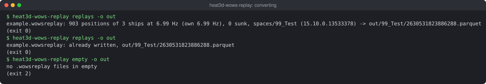

# Konvertere replayer {#converting-replays}

## Steg for steg {#step-by-step}

1. **Slå på opptak**: `isReplayEnabled` i spillets `preferences.xml`, eller spillets egen innstilling der
   den finnes. Fra da av lagrer spillet hvert slag i mappen `replays` i din World of Warships-installasjon, for
   eksempel `C:\Games\World_of_Warships_EU\replays`.
2. **Åpne en terminal** i en mappe der resultatene kan havne
   ([Før du starter](before-you-start.md)).
3. **Kjør konverteren** på replayfiler, eller på mapper som inneholder dem:

   ```bash
   heat3d-wows-replay "C:\Games\World_of_Warships_EU\replays" -o out
   heat3d-wows-replay a.wowsreplay b.wowsreplay -o out
   ```

   `out` lages i mappen terminalen står i.
4. **Les hva den sier.** Du bør se én linje per replay, som slutter med tabellen den skrev.
5. **Åpne resultatet** i 3DHeat-visningsprogrammet: `out/<kart>/<kamp>.parquet`
   i fanen Varmekart, `<kamp>.match.json` i fanen Kamp. Eller les dem med en
   hvilken som helst Parquet- eller JSON-leser.



Bildet viser en kjøring på en replay som testene lager i kode (ingen ekte replay):

- en replay konvertert: `<fil>: <n> positions of <n> ships at <rate> Hz (own <rate> Hz), <n> sunk, <kart> (<klientversjon>) -> <tabell>`;
- kjørt igjen, hopper den allerede skrevne kampen over: `<fil>: already written, <tabell>`;
- en fil som ikke er en replay: `<fil>: not converted: <årsak>` (på feilutdata; exit-status 1,
  de andre replayene konverteres likevel);
- ingen replay funnet: `no .wowsreplay files in <mapper>` (exit-status 2).

## Valg {#options}

| Valg | Standard | Gjør |
|---|---|---|
| `replays` (én eller flere) | - | `.wowsreplay`-filer, eller mapper der det søkes etter dem (også undermapper) |
| `-o`, `--out` | påkrevd | mappen det skrives til: en mappe per kart inni |
| `--force` | av | konverter på nytt det som allerede er skrevet |
| `--ship-names JSON` | - | en JSON-fil `{"<skipsId>": "<navn>", ...}`: replayer navngir bare opptakspilotens skip, de andre med nummer |
| `--version` | - | skriv `heat3d-wows-replay <versjon>` og stopp |
| `-h`, `--help` | - | skriv ut valgene og stopp |

Valgene slik programmet skriver dem ut: [Kommandoreferanse](../cli-reference.md).

## Hva som skrives {#what-is-written}

Bare løse filer: denne konverteren skriver ingen `.3dheat`-fil (visningsprogrammet kan pakke
dem til én: [Én fil per kamp](https://holdi601.github.io/3DHeat/container.html)).
Per replay, inn i `out/<kart>/` (kartets navn uten `spaces/`):

| Fil | Hva |
|---|---|
| `<kamp>.parquet` | tabellen: hvert skips posisjon over tid og hver hendelse der den skjedde ([Tabellen](table.md)) |
| `<kamp>.match.json` | kampdokumentet: kart, klientversjon, spillere, senkinger, chat og alt annet ([Kampdokumentet](match-document.md)) |
| `<kamp>.messages.parquet` | sidefilen: hver post i replayen som de to filene over ikke holder helt ([Fullstendighet](completeness.md)) |

`<kamp>` er slagets egen ID, eller filens navn når opptaket stoppet før resultatene.

## Exit-status {#exit-status}

`0` når hver replay ble konvertert eller hoppet over, `1` når noen mislyktes (de andre
konverteres likevel), `2` når ingen replayfil ble funnet.

---

Del av [3DHeat](https://github.com/Holdi601/3DHeat) ([dokumentasjon](https://holdi601.github.io/3DHeat/)). Kilde: [3DHeat-Ext-WoWs](https://github.com/Holdi601/3DHeat-Ext-WoWs).
