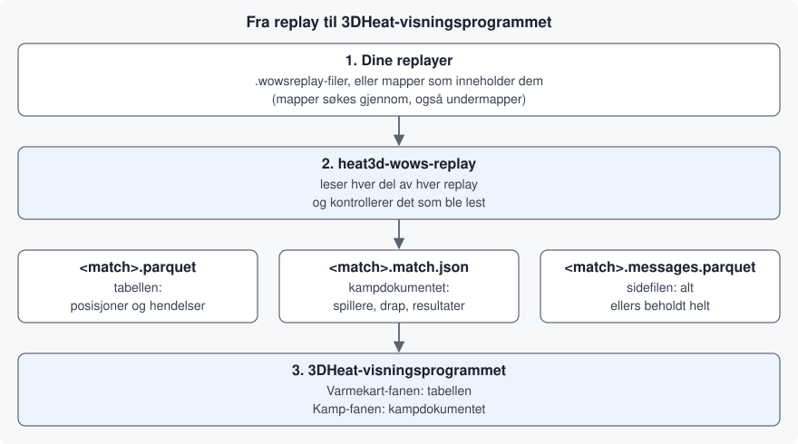

# 3DHeat-replayer fra World of Warships {#dheat-world-of-warships-replays}

**Hva er det?** World of Warships kan lagre hvert slag du spiller som en replay-fil.
Dette verktøyet gjør disse filene om til en tabell og et kampdokument (slagets
oppsummering) som [3DHeat-visningsprogrammet](https://holdi601.github.io/3DHeat/)
viser i 3D: hvor hvert skip seilte, skjøt og ble truffet.

**Hvorfor skulle jeg bruke det?** For å se et slag på nytt ovenfra, alle skipene
samtidig; for å se varmekart over hvor du og andre seiler, kjemper og synker over
hundrevis av slag; for å se hvor granater og torpedoer gikk; eller for å lese en
replay med egne skript, siden resultatet er vanlig Parquet og JSON.

**Eksempel:** én replay-fil inn, en tabell og et kampdokument ut:



## Hurtigstart {#quick-start}

Ny på kommandolinjen? Les [Før du starter](before-you-start.md) først.

```bash
git clone https://github.com/Holdi601/3DHeat-Ext-WoWs.git
cd 3DHeat-Ext-WoWs
pip install -e .
heat3d-wows-replay "<World of Warships>/replays" -o out
```

Du bør se én linje per replay, som slutter med filen den skrev:
`... -> out/<kart>/<kamp>.parquet`. Åpne den filen og
`<kamp>.match.json` ved siden av den i 3DHeat-visningsprogrammet.

## Denne dokumentasjonen {#this-documentation}

| Side | Hva den dekker |
|---|---|
| [Før du starter](before-you-start.md) | Python, en terminal, og hva suksess ser ut som |
| [Installere](installing.md) | installasjon, sjekk, oppdateringer |
| [Konvertere replayer](converting.md) | steg for steg, alle valg, meldinger, exit-status |
| [Tabellen](table.md) | hver kolonne og hver hendelse i `<kamp>.parquet` |
| [Kampdokumentet](match-document.md) | hver nøkkel i `<kamp>.match.json` |
| [Slik leser den en replay](how-it-reads.md) | formatet, og hvordan lesingen ble kontrollert |
| [Fullstendighet](completeness.md) | sidefilen og selvkontrollen |
| [Vilkår og lisens](terms.md) | Wargamings vilkår, lisens, kilder |
| [Kommandoreferanse](../cli-reference.md), [Kolonneliste](../columns.md) | generert fra koden |

## Del av 3DHeat {#part-of-3dheat}

Denne konverteren er et av verktøyene i [3DHeat](https://github.com/Holdi601/3DHeat),
en sanntids 3D-visning for telemetri og replayer ([dokumentasjon](https://holdi601.github.io/3DHeat/)).
Visningsprogrammet åpner tabellen i fanen Varmekart og kampdokumentet i fanen Kamp.
Det kan pakke filene for ett slag til én fil:
[Én fil per kamp](https://holdi601.github.io/3DHeat/container.html). Det hver
konverter må beholde: [Konvertere beholder alt](https://holdi601.github.io/3DHeat/converters.html).

Konverteren holdes adskilt fra 3DHeat Watcher med vilje: replayene er kryptert, og
Wargamings vilkår er vide ([Vilkår og lisens](terms.md)). Skulle den noen gang måtte
bort, går ingenting annet med den. Watcher kjører den når den er installert, og
fungerer uten den.

| Verktøy | Hva det gjør | Kilde | Dokumentasjon |
|---|---|---|---|
| 3DHeat-visningsprogrammet | viser dataene i 3D: varmekart, replayer, løpsanalyse | [3DHeat](https://github.com/Holdi601/3DHeat) | [nettsted](https://holdi601.github.io/3DHeat/) |
| GameFiles | kurs og nivåer fra filene spill leveres med | [3DHeat-GameFiles](https://github.com/Holdi601/3DHeat-GameFiles) | [nettsted](https://holdi601.github.io/3DHeat-GameFiles/) |
| GameCapture | runde-telemetri, og nivåer bygget opp fra spillvideo | [3DHeat-GameCapture](https://github.com/Holdi601/3DHeat-GameCapture) | [nettsted](https://holdi601.github.io/3DHeat-GameCapture/) |
| Unreal Exporter | en plugin for Unreal Editor som eksporterer et nivå | [3DHeat-UnrealExporter](https://github.com/Holdi601/3DHeat-UnrealExporter) | [nettsted](https://holdi601.github.io/3DHeat-UnrealExporter/) |
| CS2 | Counter-Strike 2-demoer og kart | [3DHeat-CS2](https://github.com/Holdi601/3DHeat-CS2) | [nettsted](https://holdi601.github.io/3DHeat-CS2/) |
| Watcher | tar opp det spill publiserer mens du spiller | [3DHeat-Watcher](https://github.com/Holdi601/3DHeat-Watcher) | [nettsted](https://holdi601.github.io/3DHeat-Watcher/) |
| War Thunder-replayer | `.wrpl`-replayer og War Thunder-nivåer | [3DHeat-Ext-WarThunder](https://github.com/Holdi601/3DHeat-Ext-WarThunder) | [nettsted](https://holdi601.github.io/3DHeat-Ext-WarThunder/) |
| World of Tanks-replayer | `.wotreplay`-replayer | [3DHeat-Ext-WoT](https://github.com/Holdi601/3DHeat-Ext-WoT) | [nettsted](https://holdi601.github.io/3DHeat-Ext-WoT/) |
| World of Warships-replayer | `.wowsreplay`-replayer | [3DHeat-Ext-WoWs](https://github.com/Holdi601/3DHeat-Ext-WoWs) | [nettsted](https://holdi601.github.io/3DHeat-Ext-WoWs/) |
| Squad-demoer | demoer fra Squad-servere | [3DHeat-Ext-Squad](https://github.com/Holdi601/3DHeat-Ext-Squad) | [nettsted](https://holdi601.github.io/3DHeat-Ext-Squad/) |
| DCS-kart | DCS World-kart som 3D-nivåer | [3DHeat-Ext-DCS](https://github.com/Holdi601/3DHeat-Ext-DCS) | [nettsted](https://holdi601.github.io/3DHeat-Ext-DCS/) |
| IL-2-kart | IL-2 Great Battles-kart som 3D-nivåer | [3DHeat-Ext-IL2](https://github.com/Holdi601/3DHeat-Ext-IL2) | [nettsted](https://holdi601.github.io/3DHeat-Ext-IL2/) |

---

Kilde: [3DHeat-Ext-WoWs](https://github.com/Holdi601/3DHeat-Ext-WoWs).
