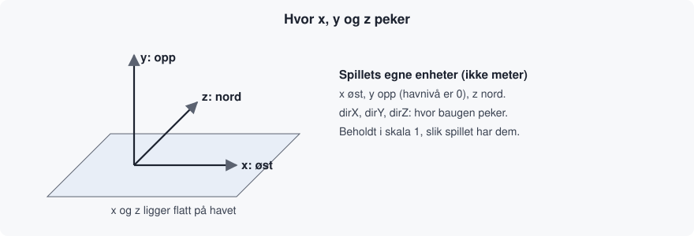

# Tabellen {#the-table}

Én rad per sample eller hendelse, i `<kamp>.parquet`: 31 kolonner
([Kolonneliste](../columns.md), generert fra koden).

| Kolonne | Hva |
|---|---|
| `match`, `map` | slagets ID; kartet (`spaces/99_testmap` i bildene) |
| `time` | sekunder siden opptaket startet (nedtellingen er med) |
| `battleTime` | sekunder siden slaget startet; negativ under nedtellingen |
| `event` | hva raden er (under) |
| `player`, `team`, `own` | spillerens navn; `ally` eller `enemy` for opptakspiloten; `1` på opptakspilotens rader |
| `vehicle`, `type` | opptakspilotens skip med navn (`PASB018-Iowa-1944`), de andre med spillets skipsnummer (`4253956080`) med mindre `--ship-names` navngir dem; `battleship`, `cruiser`, `destroyer`, `aircraft carrier`, `submarine` der navnet sier det, ellers `ship` |
| `x`, `y`, `z` | spillets verdensenheter: x øst, y opp (havnivå 0), z nord |
| `dirX`, `dirY`, `dirZ` | hvor baugen peker, en enhetsvektor i samme ramme (`dirY` 0: bare retning); på en granat eller torpedo veien den gikk |
| `other`, `reason` | den andre skipet i en hendelse (dreper, offer, angriper); spillets årsaksnummer for en senking (ikke navngitt), treffypen for et nedslag, kanalen for chat |
| `value`, `health` | hendelsens tall (skade, en granats eller torpedos hastighet i verdensenheter per sekund); skipets helse etter et treff |
| `text` | en chat-linje |
| `shot`, `params` | en salves ID; granatens eller torpedoens type, som spillets parameternummer |
| `entity` | skipets ID i replayen |
| `otherVehicle`, `otherType` | på et `impact` på et skip: det skipet og dets klasse |
| `hitLocalX`, `hitLocalY`, `hitLocalZ` | på et `impact` på et skip: der granaten endte, i det skipets egen ramme, i meter (verdensenheter ganger 15): x forover, y opp fra havet, z høyre |
| `pitch`, `roll` | på en posisjon, skipets stigning og rull (radianer) slik spillet sender dem: et skip krenger i en sving |

| `event` | På raden til | Hva |
|---|---|---|
| `position` | hvert skip | mens klienten så det |
| `death`, `kill` | offeret, dreperen | hver senking to ganger: der skipet sank, og der dets dreper var |
| `hurt`, `damage` | offeret, angriperen | et treff: `value` skaden, `health` det som er igjen |
| `shot` | skytteren | én rad per granat, ved kanonen, i retningen den fløy |
| `torpedo` | skytteren | én rad per torpedo, der den ble skutt ut, i retningen den gikk |
| `impact` | skytteren | der en granat endte (treff, bom ut i vannet, ...); `reason` treffypenummeret; på et skip (enhver type unntatt 0 vann, 8, 32, 64 land, innen 6 enheter fra et skip) `other`/`otherVehicle`/`otherType` skipet og `hitLocalX/Y/Z` punktet i dets ramme (over) |
| `chat` | avsenderen | `text` linjen, `reason` kanalen (`battle_team`, `battle_common`) |

**Enheter.** En verdensenhet er ikke en meter. Et slagskip i fart dekker omtrent 2,4
av dem i sekundet, og et kart er omtrent 1 200 på tvers. Målt mot skipenes skrogs geometri er en enhet 15 m;
spillets egne rekkeviddetall gjør den til 30 m (landaire/wows-toolkit, `crates/wows-core/src/units.rs`, MIT, som lar
de to stå uavstemt). Tabellen beholder verdensenheter i skala 1, slik alle 3DHeat-kilder beholder sitt spills egne
enheter, så et nivå eksportert i samme enheter stemmer. Bunnteksten under `heat3d` gir hintene: y opp, z snudd (så kartet
ikke speiles), et skip 12 enheter langt, `player` som personen, `team` som gruppen, `match` som økten.

---

Del av [3DHeat](https://github.com/Holdi601/3DHeat) ([dokumentasjon](https://holdi601.github.io/3DHeat/)). Kilde: [3DHeat-Ext-WoWs](https://github.com/Holdi601/3DHeat-Ext-WoWs).
