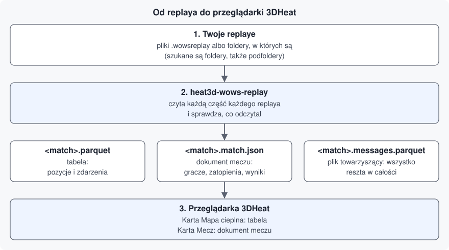

# Repliki World of Warships w 3DHeat {#dheat-world-of-warships-replays}

**Co to jest?** World of Warships może zapisać każdą rozegraną bitwę jako plik
replay. To narzędzie zamienia te pliki w tabelę i dokument meczu (podsumowanie
bitwy), które [przeglądarka 3DHeat](https://holdi601.github.io/3DHeat/) pokazuje w 3D:
gdzie płynął każdy okręt, strzelał i był trafiany.

**Po co mi to?** Żeby obejrzeć bitwę jeszcze raz z góry, wszystkie okręty naraz;
żeby zobaczyć mapy cieplne tego, gdzie Ty i inni pływacie, walczycie i toniecie w
setkach bitew; żeby zobaczyć, dokąd poleciały pociski i torpedy; albo żeby czytać replay
własnymi skryptami, bo wynik to zwykły Parquet i JSON.

**Przykład:** jeden plik replaya na wejściu, tabela i dokument meczu na wyjściu:



## Szybki start {#quick-start}

Nowy w wierszu poleceń? Najpierw przeczytaj [Zanim zaczniesz](before-you-start.md).

```bash
git clone https://github.com/Holdi601/3DHeat-Ext-WoWs.git
cd 3DHeat-Ext-WoWs
pip install -e .
heat3d-wows-replay "<World of Warships>/replays" -o out
```

Zobaczysz jedną linię na replay, kończącą się plikiem, który zapisał:
`... -> out/<map>/<match>.parquet`. Otwórz ten plik i obok niego
`<match>.match.json` w przeglądarce 3DHeat.

## Ta dokumentacja {#this-documentation}

| Strona | Czego dotyczy |
|---|---|
| [Zanim zaczniesz](before-you-start.md) | Python, terminal i jak wygląda sukces |
| [Instalacja](installing.md) | instalacja, sprawdzenie, aktualizacje |
| [Konwertowanie replayów](converting.md) | krok po kroku, każda opcja, komunikaty, status wyjścia |
| [Tabela](table.md) | każda kolumna i każde zdarzenie `<match>.parquet` |
| [Dokument meczu](match-document.md) | każdy klucz `<match>.match.json` |
| [Jak czytany jest replay](how-it-reads.md) | format i jak sprawdzono odczyt |
| [Kompletność](completeness.md) | plik towarzyszący i samosprawdzenie |
| [Warunki i licencja](terms.md) | warunki Wargaming, licencja, źródła |
| [Opis poleceń](../cli-reference.md), [Lista kolumn](../columns.md) | generowane z kodu |

## Część 3DHeat {#part-of-3dheat}

Ten konwerter jest jednym z narzędzi [3DHeat](https://github.com/Holdi601/3DHeat),
przeglądarki danych telemetrycznych i replayów w 3D w czasie rzeczywistym ([dokumentacja](https://holdi601.github.io/3DHeat/)).
Przeglądarka otwiera tabelę na karcie Mapa cieplna, a dokument meczu na karcie
Mecz. Może też spakować pliki meczu w jeden plik:
[Jeden plik na mecz](https://holdi601.github.io/3DHeat/container.html). Czego musi dotrzymać każdy
konwerter: [Konwertery zachowują wszystko](https://holdi601.github.io/3DHeat/converters.html).

Konwerter jest trzymany osobno od 3DHeat Watcher celowo: replaye są zaszyfrowane,
a warunki Wargaming są szerokie ([Warunki i licencja](terms.md)).
Gdyby musiał zniknąć, nic innego nie znika razem z nim. Watcher uruchamia go, gdy jest
zainstalowany, i działa bez niego.

| Narzędzie | Co robi | Źródło | Dokumentacja |
|---|---|---|---|
| przeglądarka 3DHeat | pokazuje dane w 3D: mapy cieplne, replaye, analiza wyścigów | [3DHeat](https://github.com/Holdi601/3DHeat) | [strona](https://holdi601.github.io/3DHeat/) |
| GameFiles | trasy i poziomy z plików, które gry dołączają | [3DHeat-GameFiles](https://github.com/Holdi601/3DHeat-GameFiles) | [strona](https://holdi601.github.io/3DHeat-GameFiles/) |
| GameCapture | telemetria okrążeń i poziomy odtworzone z nagrań wideo z rozgrywki | [3DHeat-GameCapture](https://github.com/Holdi601/3DHeat-GameCapture) | [strona](https://holdi601.github.io/3DHeat-GameCapture/) |
| Unreal Exporter | wtyczka do Unreal Editor, która eksportuje poziom | [3DHeat-UnrealExporter](https://github.com/Holdi601/3DHeat-UnrealExporter) | [strona](https://holdi601.github.io/3DHeat-UnrealExporter/) |
| CS2 | dema i mapy Counter-Strike 2 | [3DHeat-CS2](https://github.com/Holdi601/3DHeat-CS2) | [strona](https://holdi601.github.io/3DHeat-CS2/) |
| Watcher | zapisuje to, co gry publikują podczas grania | [3DHeat-Watcher](https://github.com/Holdi601/3DHeat-Watcher) | [strona](https://holdi601.github.io/3DHeat-Watcher/) |
| Replaye War Thunder | replaye `.wrpl` i poziomy War Thunder | [3DHeat-Ext-WarThunder](https://github.com/Holdi601/3DHeat-Ext-WarThunder) | [strona](https://holdi601.github.io/3DHeat-Ext-WarThunder/) |
| Replaye World of Tanks | replaye `.wotreplay` | [3DHeat-Ext-WoT](https://github.com/Holdi601/3DHeat-Ext-WoT) | [strona](https://holdi601.github.io/3DHeat-Ext-WoT/) |
| Replaye World of Warships | replaye `.wowsreplay` | [3DHeat-Ext-WoWs](https://github.com/Holdi601/3DHeat-Ext-WoWs) | [strona](https://holdi601.github.io/3DHeat-Ext-WoWs/) |
| Dema Squad | dema serwerów Squad | [3DHeat-Ext-Squad](https://github.com/Holdi601/3DHeat-Ext-Squad) | [strona](https://holdi601.github.io/3DHeat-Ext-Squad/) |
| Mapy DCS | mapy DCS World jako poziomy 3D | [3DHeat-Ext-DCS](https://github.com/Holdi601/3DHeat-Ext-DCS) | [strona](https://holdi601.github.io/3DHeat-Ext-DCS/) |
| Mapy IL-2 | mapy IL-2 Great Battles jako poziomy 3D | [3DHeat-Ext-IL2](https://github.com/Holdi601/3DHeat-Ext-IL2) | [strona](https://holdi601.github.io/3DHeat-Ext-IL2/) |

---

Źródło: [3DHeat-Ext-WoWs](https://github.com/Holdi601/3DHeat-Ext-WoWs).
