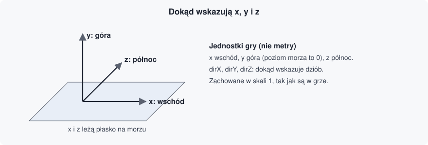

# Tabela {#the-table}

Jeden wiersz na próbkę lub zdarzenie, w `<match>.parquet`: 31 kolumn
([Lista kolumn](../columns.md), generowana z kodu).

| Kolumna | Co to jest |
|---|---|
| `match`, `map` | identyfikator bitwy; mapa (`spaces/99_testmap` na obrazkach) |
| `time` | sekundy od rozpoczęcia nagrania (odliczanie też w nim jest) |
| `battleTime` | sekundy od rozpoczęcia bitwy; ujemne podczas odliczania |
| `event` | czym jest wiersz (poniżej) |
| `player`, `team`, `own` | nazwa gracza; `ally` albo `enemy` wobec nagrywającego gracza; `1` w wierszach nagrywającego gracza |
| `vehicle`, `type` | okręt nagrywającego gracza wg nazwy (`PASB018-Iowa-1944`), pozostałe wg numeru okrętu w grze (`4253956080`), chyba że `--ship-names` je nazwie; `battleship`, `cruiser`, `destroyer`, `aircraft carrier`, `submarine`, gdy wynika to z nazwy, w przeciwnym razie `ship` |
| `x`, `y`, `z` | jednostki świata gry: x na wschód, y w górę (poziom morza 0), z na północ |
| `dirX`, `dirY`, `dirZ` | dokąd wskazuje dziób, wektor jednostkowy w tym samym układzie (`dirY` 0: sam kurs); przy pocisku lub torpedzie – dokąd leciały |
| `other`, `reason` | drugi okręt zdarzenia (zabójca, ofiara, atakujący); numer przyczyny gry przy zatonięciu (nienazwany), rodzaj trafienia przy uderzeniu, kanał przy czacie |
| `value`, `health` | liczba zdarzenia (obrażenia, prędkość pocisku lub torpedy w jednostkach świata na sekundę); zdrowie okrętu po trafieniu |
| `text` | linia czatu |
| `shot`, `params` | identyfikator salwy; typ pocisku lub torpedy jako numer parametru gry |
| `entity` | identyfikator okrętu w replayu |
| `otherVehicle`, `otherType` | przy `impact` na okręcie: ten okręt i jego klasa |
| `hitLocalX`, `hitLocalY`, `hitLocalZ` | przy `impact` na okręcie: gdzie pocisk zakończył lot w układzie tego okrętu, w metrach (jednostki świata razy 15): x przód, y w górę od morza, z prawo |
| `pitch`, `roll` | przy pozycji: pochylenie i przechył okrętu (radiany), tak jak wysyła je gra: okręt przechyla się w zakręcie |

| `event` | W wierszu | Co to jest |
|---|---|---|
| `position` | każdego okrętu | gdy klient go widział |
| `death`, `kill` | ofiary, zabójcy | każde zatonięcie dwa razy: gdzie okręt zatonął i gdzie stał jego zabójca |
| `hurt`, `damage` | ofiary, atakującego | trafienie: `value` obrażenia, `health` co zostało |
| `shot` | strzelca | jeden wiersz na pocisk, przy dziale, w kierunku, w którym leciał |
| `torpedo` | strzelca | jeden wiersz na torpedę, w miejscu wystrzelenia, w kierunku, w którym płynęła |
| `impact` | strzelca | miejsce, w którym pocisk zakończył lot (trafienie, pudło do wody, ...); `reason` numer rodzaju trafienia; na okręcie (dowolny typ oprócz 0 woda, 8, 32, 64 ląd, w odległości 6 jednostek od okrętu) `other`/`otherVehicle`/`otherType` okręt, a `hitLocalX/Y/Z` punkt w jego układzie (jak wyżej) |
| `chat` | nadawcę | `text` linia, `reason` kanał (`battle_team`, `battle_common`) |

**Jednostki.** Jednostka świata to nie metr. Pancernik na pełnej prędkości pokonuje
ich około 2,4 na sekundę, a mapa ma około 1200 w poprzek. Mierzona względem
geometrii kadłubów okrętów, jednostka to 15 m; wg własnych zasięgów gry to 30 m
(landaire/wows-toolkit, `crates/wows-core/src/units.rs`, MIT, który nie godzi
obu). Tabela zachowuje jednostki świata w skali 1, tak jak każde źródło 3DHeat zachowuje
własne jednostki gry, więc poziom wyeksportowany w tych samych jednostkach dobrze pasuje. Wskazówki w stopce
`heat3d`: Y w górę, Z odwrócone (żeby mapa nie była odbita),
okręt długi na 12 jednostek, `player` jako osoba, `team` jako grupa, `match` jako sesja.

---

Część [3DHeat](https://github.com/Holdi601/3DHeat) ([dokumentacja](https://holdi601.github.io/3DHeat/)). Źródło: [3DHeat-Ext-WoWs](https://github.com/Holdi601/3DHeat-Ext-WoWs).
