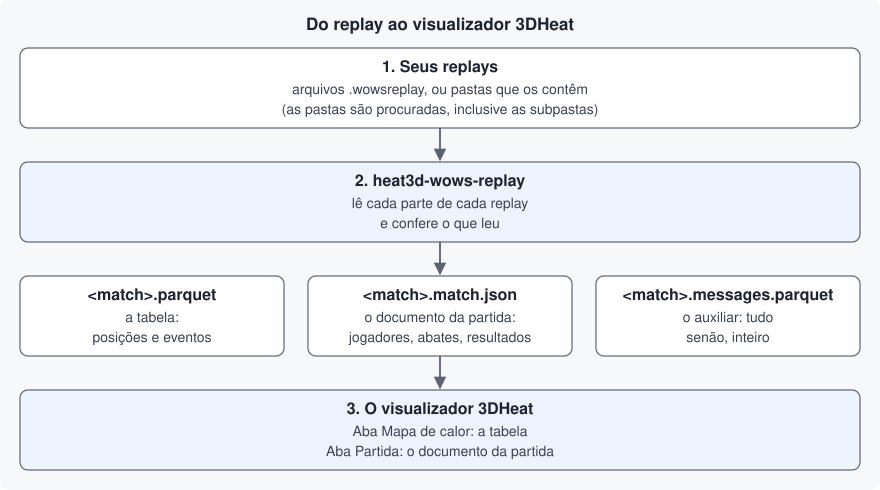

# Replays de World of Warships no 3DHeat {#dheat-world-of-warships-replays}

**O que é?** O World of Warships pode salvar cada batalha que você joga como um arquivo de
replay. Esta ferramenta transforma esses arquivos em uma tabela e num documento da partida
(o resumo da batalha) que o [visualizador 3DHeat](https://holdi601.github.io/3DHeat/) mostra
em 3D: por onde cada navio navegou, atirou e foi atingido.

**Para que serve?** Para assistir a uma batalha de novo, de cima, com todos os navios ao
mesmo tempo; para ver mapas de calor de por onde você e outros navegam, lutam e afundam em
centenas de batalhas; para ver aonde foram os projéteis e torpedos; ou para ler um replay com
os seus próprios scripts, já que a saída é Parquet e JSON simples.

**Exemplo:** um arquivo de replay entra, uma tabela e um documento da partida saem:



## Início rápido {#quick-start}

Nunca usou a linha de comando? Leia primeiro [Antes de começar](before-you-start.md).

```bash
git clone https://github.com/Holdi601/3DHeat-Ext-WoWs.git
cd 3DHeat-Ext-WoWs
pip install -e .
heat3d-wows-replay "<World of Warships>/replays" -o out
```

Você deve ver uma linha por replay, terminando no arquivo que ele gravou:
`... -> out/<map>/<match>.parquet`. Abra esse arquivo e o `<match>.match.json` ao lado dele
no visualizador 3DHeat.

## Esta documentação {#this-documentation}

| Página | O que traz |
|---|---|
| [Antes de começar](before-you-start.md) | Python, um terminal e como é um resultado de sucesso |
| [Instalação](installing.md) | instalar, conferir, atualizações |
| [Converter replays](converting.md) | passo a passo, cada opção, mensagens, status de saída |
| [A tabela](table.md) | cada coluna e cada evento de `<match>.parquet` |
| [O documento da partida](match-document.md) | cada chave de `<match>.match.json` |
| [Como ele lê um replay](how-it-reads.md) | o formato, e como a leitura foi verificada |
| [Completude](completeness.md) | o arquivo auxiliar e a autoverificação |
| [Termos e licença](terms.md) | o que ele lê, licença, fontes |
| [Referência de comandos](../cli-reference.md), [Lista de colunas](../columns.md) | gerados a partir do código |

## Parte do 3DHeat {#part-of-3dheat}

Este conversor é uma das ferramentas do [3DHeat](https://github.com/Holdi601/3DHeat),
um visualizador de telemetria e replays 3D em tempo real ([documentação](https://holdi601.github.io/3DHeat/)).
O visualizador abre a tabela na sua aba Mapa de calor e o documento da partida na sua aba
Partida. Ele também pode empacotar os arquivos de uma partida num só arquivo:
[Um arquivo por partida](https://holdi601.github.io/3DHeat/container.html). O que todo
conversor precisa manter: [Conversores mantêm tudo](https://holdi601.github.io/3DHeat/converters.html).

Cada leitor de jogo é um pequeno projeto próprio, com seu próprio arquivo de
licença, suas versões e seu rastreador de problemas, para poder ser instalado,
atualizado, mantido - ou retirado a pedido de um titular de direitos - por
conta própria, sem afetar o visualizador nem as outras ferramentas. O Watcher
executa este conversor quando ele está instalado e funciona sem ele. O que o
conversor lê: [Termos e licença](terms.md).

| Ferramenta | O que faz | Código | Documentação |
|---|---|---|---|
| Visualizador 3DHeat | mostra os dados em 3D: mapas de calor, replays, análise de corrida | [3DHeat](https://github.com/Holdi601/3DHeat) | [site](https://holdi601.github.io/3DHeat/) |
| GameFiles | percursos e níveis extraídos dos arquivos que os jogos trazem | [3DHeat-GameFiles](https://github.com/Holdi601/3DHeat-GameFiles) | [site](https://holdi601.github.io/3DHeat-GameFiles/) |
| GameCapture | telemetria de voltas, e níveis reconstruídos a partir de vídeo de jogo | [3DHeat-GameCapture](https://github.com/Holdi601/3DHeat-GameCapture) | [site](https://holdi601.github.io/3DHeat-GameCapture/) |
| Unreal Exporter | um plugin do Unreal Editor que exporta um nível | [3DHeat-UnrealExporter](https://github.com/Holdi601/3DHeat-UnrealExporter) | [site](https://holdi601.github.io/3DHeat-UnrealExporter/) |
| CS2 | demos e mapas do Counter-Strike 2 | [3DHeat-CS2](https://github.com/Holdi601/3DHeat-CS2) | [site](https://holdi601.github.io/3DHeat-CS2/) |
| Watcher | registra o que os jogos publicam enquanto você joga | [3DHeat-Watcher](https://github.com/Holdi601/3DHeat-Watcher) | [site](https://holdi601.github.io/3DHeat-Watcher/) |
| Replays de War Thunder | replays `.wrpl` e níveis do War Thunder | [3DHeat-Ext-WarThunder](https://github.com/Holdi601/3DHeat-Ext-WarThunder) | [site](https://holdi601.github.io/3DHeat-Ext-WarThunder/) |
| Replays de World of Tanks | replays `.wotreplay` | [3DHeat-Ext-WoT](https://github.com/Holdi601/3DHeat-Ext-WoT) | [site](https://holdi601.github.io/3DHeat-Ext-WoT/) |
| Replays de World of Warships | replays `.wowsreplay` | [3DHeat-Ext-WoWs](https://github.com/Holdi601/3DHeat-Ext-WoWs) | [site](https://holdi601.github.io/3DHeat-Ext-WoWs/) |
| Demos de Squad | demos de servidor do Squad | [3DHeat-Ext-Squad](https://github.com/Holdi601/3DHeat-Ext-Squad) | [site](https://holdi601.github.io/3DHeat-Ext-Squad/) |
| Mapas de DCS | mapas do DCS World como níveis 3D | [3DHeat-Ext-DCS](https://github.com/Holdi601/3DHeat-Ext-DCS) | [site](https://holdi601.github.io/3DHeat-Ext-DCS/) |
| Mapas de IL-2 | mapas do IL-2 Great Battles como níveis 3D | [3DHeat-Ext-IL2](https://github.com/Holdi601/3DHeat-Ext-IL2) | [site](https://holdi601.github.io/3DHeat-Ext-IL2/) |

---

Código: [3DHeat-Ext-WoWs](https://github.com/Holdi601/3DHeat-Ext-WoWs).
