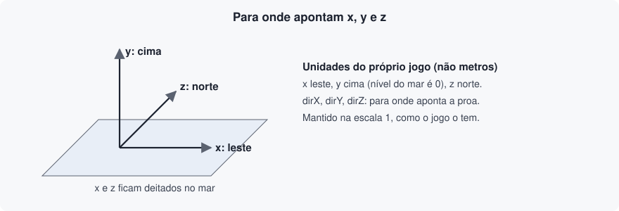

# A tabela {#the-table}

Uma linha por amostra ou evento, em `<match>.parquet`: 31 colunas ([Lista de colunas](../columns.md), gerada a partir do código).

| Coluna | O que é |
|---|---|
| `match`, `map` | o id da batalha; o mapa (`spaces/99_testmap` nas figuras) |
| `time` | segundos desde o início da gravação (a contagem regressiva está nele) |
| `battleTime` | segundos desde o início da batalha; negativos durante a contagem regressiva |
| `event` | o que a linha representa (abaixo) |
| `player`, `team`, `own` | o nome do jogador; `ally` ou `enemy` do jogador que grava; `1` nas linhas do jogador que grava |
| `vehicle`, `type` | o navio do jogador que grava pelo nome (`PASB018-Iowa-1944`), os outros pelo número do navio no jogo (`4253956080`), salvo se `--ship-names` os nomear; `battleship`, `cruiser`, `destroyer`, `aircraft carrier`, `submarine` quando o nome o diz, senão `ship` |
| `x`, `y`, `z` | as unidades do mundo do jogo: x leste, y cima (nível do mar 0), z norte |
| `dirX`, `dirY`, `dirZ` | para onde aponta a proa, um vetor unitário no mesmo referencial (`dirY` 0: só o rumo); num projétil ou torpedo, o sentido em que foi |
| `other`, `reason` | o outro navio de um evento (abatedor, vítima, atacante); o número da causa do jogo num afundamento (sem nome), o tipo de impacto num impacto, o canal no chat |
| `value`, `health` | o número do evento (dano, velocidade de um projétil ou torpedo em unidades do mundo por segundo); a vida do navio depois de um acerto |
| `text` | uma linha de chat |
| `shot`, `params` | o id de uma salva; o tipo do projétil ou torpedo, como o número de parâmetro do jogo |
| `entity` | o id do navio no replay |
| `otherVehicle`, `otherType` | num `impact` em um navio: esse navio e a sua classe |
| `hitLocalX`, `hitLocalY`, `hitLocalZ` | num `impact` em um navio: onde o projétil terminou, no referencial próprio desse navio, em metros (unidades do mundo vezes 15): x para a frente, y para cima a partir do mar, z para a direita |
| `pitch`, `roll` | numa posição, a arfagem e o rolamento do navio (radianos) como o jogo os envia: um navio inclina numa curva |

| `event` | Na linha de | O que é |
|---|---|---|
| `position` | cada navio | enquanto o cliente o via |
| `death`, `kill` | a vítima, o abatedor | cada afundamento duas vezes: onde o navio afundou, e onde estava o seu abatedor |
| `hurt`, `damage` | a vítima, o atacante | um acerto: `value` o dano, `health` o que restou |
| `shot` | o atirador | uma linha por projétil, no canhão, na direção em que voou |
| `torpedo` | o atirador | uma linha por torpedo, onde foi lançado, na direção em que correu |
| `impact` | o atirador | onde um projétil terminou (acerto, erro na água, ...); `reason` o número do tipo de acerto; num navio (qualquer tipo menos 0 água, 8, 32, 64 terra, a menos de 6 unidades de um navio) `other`/`otherVehicle`/`otherType` o navio e `hitLocalX/Y/Z` o ponto no referencial dele (acima) |
| `chat` | o remetente | `text` a linha, `reason` o canal (`battle_team`, `battle_common`) |

**Unidades.** Uma unidade do mundo não é um metro. Um encouraçado em velocidade percorre cerca de
2,4 delas por segundo, e um mapa tem cerca de 1.200 de lado. Medida contra a geometria dos cascos
dos navios, uma unidade vale 15 m; os próprios números de alcance do jogo a fazem valer 30 m
(landaire/wows-toolkit, `crates/wows-core/src/units.rs`, MIT, que deixa as duas coisas sem
reconciliar). A tabela guarda as unidades do mundo na escala 1, como toda fonte do 3DHeat guarda as
unidades próprias do seu jogo, então um nível exportado nas mesmas unidades se alinha. As dicas do
rodapé `heat3d`: Y para cima, Z invertido (para o mapa não sair espelhado), um navio com 12 unidades
de comprimento, `player` como a pessoa, `team` como o grupo, `match` como a sessão.

---

Parte do [3DHeat](https://github.com/Holdi601/3DHeat) ([documentação](https://holdi601.github.io/3DHeat/)). Código: [3DHeat-Ext-WoWs](https://github.com/Holdi601/3DHeat-Ext-WoWs).
