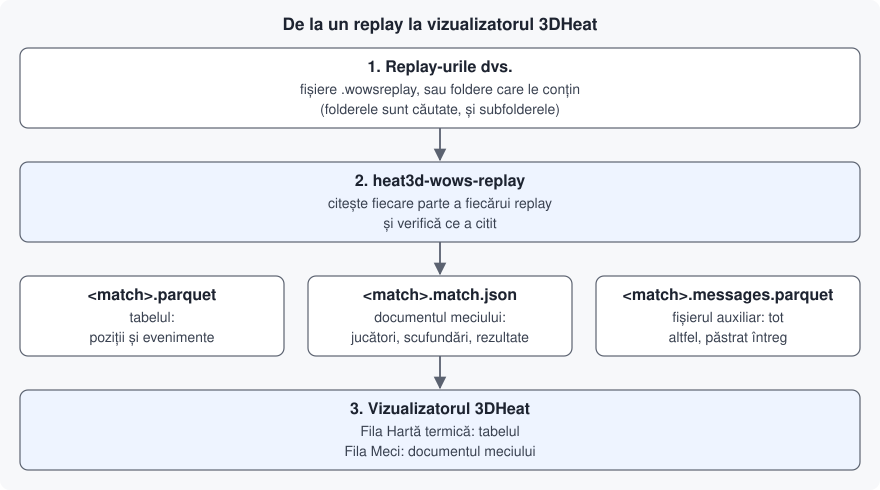

# Replay-uri World of Warships pentru 3DHeat {#dheat-world-of-warships-replays}

**Ce este?** World of Warships poate salva fiecare bătălie jucată ca fișier de replay. Acest instrument
transformă aceste fișiere într-un tabel și într-un document al meciului (rezumatul bătăliei) pe care
[vizualizatorul 3DHeat](https://holdi601.github.io/3DHeat/) le arată în 3D: unde a navigat,
a tras și a fost lovită fiecare navă.

**De ce l-ați folosi?** Ca să revedeți o bătălie de sus, toate navele odată; ca să vedeți hărți termice ale locurilor unde navigați, luptați și scufundați dumneavoastră și ceilalți, peste sute de bătălii; ca să vedeți unde au ajuns obuzele și torpilele; sau ca să citiți un replay cu propriile dumneavoastră scripturi, pentru că rezultatul este Parquet și JSON simplu.

**Exemplu:** un fișier de replay la intrare, un tabel și un document al meciului la ieșire:



## Pornire rapidă {#quick-start}

Sunteți nou cu linia de comandă? Citiți mai întâi [Înainte de început](before-you-start.md).

```bash
git clone https://github.com/Holdi601/3DHeat-Ext-WoWs.git
cd 3DHeat-Ext-WoWs
pip install -e .
heat3d-wows-replay "<World of Warships>/replays" -o out
```

Ar trebui să vedeți câte o linie pentru fiecare replay, terminată cu fișierul scris:
`... -> out/<map>/<match>.parquet`. Deschideți acel fișier și
`<match>.match.json` de lângă el în vizualizatorul 3DHeat.

## Această documentație {#this-documentation}

| Pagina | Ce acoperă |
|---|---|
| [Înainte de început](before-you-start.md) | Python, un terminal și cum arată un rezultat reușit |
| [Instalare](installing.md) | instalare, verificare, actualizări |
| [Convertirea replay-urilor](converting.md) | pas cu pas, fiecare opțiune, mesaje, codul de ieșire |
| [Tabelul](table.md) | fiecare coloană și eveniment din `<match>.parquet` |
| [Documentul meciului](match-document.md) | fiecare cheie din `<match>.match.json` |
| [Cum citește un replay](how-it-reads.md) | formatul și cum a fost verificată citirea |
| [Completitudinea](completeness.md) | fișierul auxiliar și autoverificarea |
| [Termeni și licență](terms.md) | ce citește, licența, surse |
| [Referința comenzilor](../cli-reference.md), [Lista coloanelor](../columns.md) | generate din cod |

## Parte din 3DHeat {#part-of-3dheat}

Acest convertor este unul dintre instrumentele [3DHeat](https://github.com/Holdi601/3DHeat),
un vizualizator 3D de telemetrie și replay în timp real ([documentație](https://holdi601.github.io/3DHeat/)).
Vizualizatorul deschide tabelul în fila sa Hartă termică și documentul meciului în fila sa
Meci. Poate împacheta fișierele unui meci într-un singur fișier:
[Un fișier pentru un meci](https://holdi601.github.io/3DHeat/container.html). Ce trebuie să păstreze orice
convertor: [Convertoarele păstrează tot](https://holdi601.github.io/3DHeat/converters.html).

Fiecare cititor de joc este un mic proiect propriu, cu propriul fișier de
licență, propriile versiuni și propriul sistem de urmărire a problemelor,
astfel încât poate fi instalat, actualizat, întreținut - sau retras la cererea
unui deținător de drepturi - separat, fără să afecteze vizualizatorul sau
celelalte unelte. Watcher rulează acest convertor când este instalat și
funcționează și fără el. Ce citește convertorul: [Termeni și
licență](terms.md).

| Instrument | Ce face | Sursă | Documentație |
|---|---|---|---|
| Vizualizatorul 3DHeat | arată datele în 3D: hărți termice, replay-uri, analiză de cursă | [3DHeat](https://github.com/Holdi601/3DHeat) | [site](https://holdi601.github.io/3DHeat/) |
| GameFiles | trasee și niveluri scoase din fișierele pe care le livrează jocurile | [3DHeat-GameFiles](https://github.com/Holdi601/3DHeat-GameFiles) | [site](https://holdi601.github.io/3DHeat-GameFiles/) |
| GameCapture | telemetria turelor, și niveluri reconstruite din video de joc | [3DHeat-GameCapture](https://github.com/Holdi601/3DHeat-GameCapture) | [site](https://holdi601.github.io/3DHeat-GameCapture/) |
| Unreal Exporter | un plugin pentru Unreal Editor care exportă un nivel | [3DHeat-UnrealExporter](https://github.com/Holdi601/3DHeat-UnrealExporter) | [site](https://holdi601.github.io/3DHeat-UnrealExporter/) |
| CS2 | demouri și hărți Counter-Strike 2 | [3DHeat-CS2](https://github.com/Holdi601/3DHeat-CS2) | [site](https://holdi601.github.io/3DHeat-CS2/) |
| Watcher | înregistrează ce publică jocurile cât joci | [3DHeat-Watcher](https://github.com/Holdi601/3DHeat-Watcher) | [site](https://holdi601.github.io/3DHeat-Watcher/) |
| Replay-uri War Thunder | replay-uri `.wrpl` și niveluri War Thunder | [3DHeat-Ext-WarThunder](https://github.com/Holdi601/3DHeat-Ext-WarThunder) | [site](https://holdi601.github.io/3DHeat-Ext-WarThunder/) |
| Replay-uri World of Tanks | replay-uri `.wotreplay` | [3DHeat-Ext-WoT](https://github.com/Holdi601/3DHeat-Ext-WoT) | [site](https://holdi601.github.io/3DHeat-Ext-WoT/) |
| Replay-uri World of Warships | replay-uri `.wowsreplay` | [3DHeat-Ext-WoWs](https://github.com/Holdi601/3DHeat-Ext-WoWs) | [site](https://holdi601.github.io/3DHeat-Ext-WoWs/) |
| Demouri Squad | demouri de server Squad | [3DHeat-Ext-Squad](https://github.com/Holdi601/3DHeat-Ext-Squad) | [site](https://holdi601.github.io/3DHeat-Ext-Squad/) |
| Hărți DCS | hărțile DCS World ca niveluri 3D | [3DHeat-Ext-DCS](https://github.com/Holdi601/3DHeat-Ext-DCS) | [site](https://holdi601.github.io/3DHeat-Ext-DCS/) |
| Hărți IL-2 | hărțile IL-2 Great Battles ca niveluri 3D | [3DHeat-Ext-IL2](https://github.com/Holdi601/3DHeat-Ext-IL2) | [site](https://holdi601.github.io/3DHeat-Ext-IL2/) |

---

Sursă: [3DHeat-Ext-WoWs](https://github.com/Holdi601/3DHeat-Ext-WoWs).
