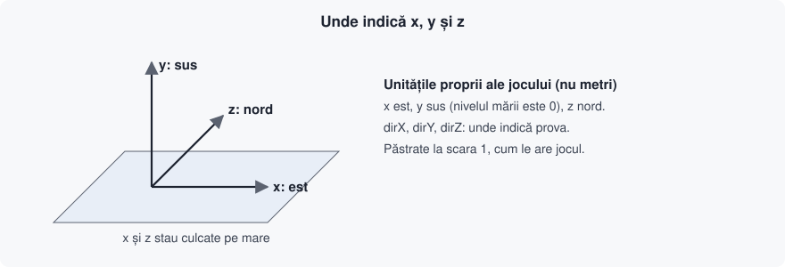

# Tabelul {#the-table}

Un rând pentru fiecare eșantion sau eveniment, în `<match>.parquet`: 31 de coloane
([Lista coloanelor](../columns.md), generată din cod).

| Coloană | Ce este |
|---|---|
| `match`, `map` | id-ul bătăliei; harta (`spaces/99_testmap` în imagini) |
| `time` | secunde de la începutul înregistrării (numărătoarea inversă este în ea) |
| `battleTime` | secunde de la începutul bătăliei; negative în timpul numărătorii inverse |
| `event` | ce este rândul (mai jos) |
| `player`, `team`, `own` | numele jucătorului; `ally` sau `enemy` al jucătorului care înregistrează; `1` pe rândurile jucătorului care înregistrează |
| `vehicle`, `type` | nava jucătorului care înregistrează după nume (`PASB018-Iowa-1944`), celelalte după numărul navei din joc (`4253956080`) dacă `--ship-names` nu le numește; `battleship`, `cruiser`, `destroyer`, `aircraft carrier`, `submarine` acolo unde o spune numele, altfel `ship` |
| `x`, `y`, `z` | unitățile lumii jocului: x est, y sus (nivelul mării 0), z nord |
| `dirX`, `dirY`, `dirZ` | unde indică prova, un vector unitar în același cadru (`dirY` 0: doar cursul); la un obuz sau o torpilă, direcția în care a mers |
| `other`, `reason` | cealaltă navă a unui eveniment (ucigaș, victimă, atacator); numărul cauzei jocului pentru o scufundare (nenumit), tipul loviturii pentru un impact, canalul pentru chat |
| `value`, `health` | numărul evenimentului (daune, viteza unui obuz sau torpile în unități ale lumii pe secundă); viața navei după o lovitură |
| `text` | o linie de chat |
| `shot`, `params` | id-ul unei salve; tipul obuzului sau torpilei, ca numărul de parametru al jocului |
| `entity` | id-ul navei în replay |
| `otherVehicle`, `otherType` | la un `impact` asupra unei nave: acea navă și clasa ei |
| `hitLocalX`, `hitLocalY`, `hitLocalZ` | la un `impact` asupra unei nave: unde a s-a oprit obuzul în cadrul propriu al acelei nave, în metri (unități ale lumii înmulțite cu 15): x înainte, y sus de la mare, z dreapta |
| `pitch`, `roll` | la o poziție, tangajul și rularea navei (radiani) cum le trimite jocul: o navă se înclină într-un viraj |

| `event` | Pe rândul cui | Ce este |
|---|---|---|
| `position` | fiecare navă | cât timp clientul a văzut-o |
| `death`, `kill` | victima, ucigașul | fiecare scufundare de două ori: unde s-a scufundat nava, și unde era ucigașul ei |
| `hurt`, `damage` | victima, atacatorul | o lovitură: `value` daunele, `health` ce rămâne |
| `shot` | trăgătorul | un rând pentru fiecare obuz, la tun, în direcția în care a zburat |
| `torpedo` | trăgătorul | un rând pentru fiecare torpilă, unde a fost lansată, în direcția în care a mers |
| `impact` | trăgătorul | unde s-a oprit un obuz (lovitură, ratare în apă, ...); `reason` numărul tipului de lovitură; pe o navă (orice tip, în afară de 0 apă, 8, 32, 64 uscat, în 6 unități de o navă) `other`/`otherVehicle`/`otherType` nava și `hitLocalX/Y/Z` punctul în cadrul ei (mai sus) |
| `chat` | expeditorul | `text` linia, `reason` canalul (`battle_team`, `battle_common`) |

**Unități.** O unitate a lumii nu este un metru. O navă de linie la viteză parcurge aproximativ 2,4
dintre ele pe secundă, iar o hartă are aproximativ 1.200 de la un capăt la altul. Așezată față de geometria corpurilor navelor, o unitate este 15 m; cifrele de rază ale jocului o fac 30 m
(landaire/wows-toolkit, `crates/wows-core/src/units.rs`, MIT, care lasă cele
două nereconciliate). Tabelul păstrează unitățile lumii la scara 1, cum păstrează fiecare sursă 3DHeat unitățile proprii ale jocului său, deci un nivel exportat în aceleași unități se aliniază.
Indiciile din subsol `heat3d`: Y sus, Z întors (ca harta să nu fie oglindită),
o navă de 12 unități lungime, `player` ca persoană, `team` ca grup, `match` ca sesiune.

---

Parte din [3DHeat](https://github.com/Holdi601/3DHeat) ([documentație](https://holdi601.github.io/3DHeat/)). Sursă: [3DHeat-Ext-WoWs](https://github.com/Holdi601/3DHeat-Ext-WoWs).
