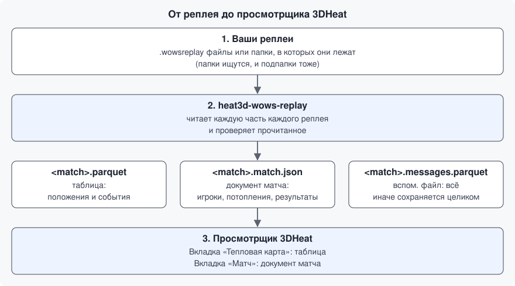

# 3DHeat: реплеи World of Warships {#dheat-world-of-warships-replays}

**Что это?** World of Warships может сохранить каждый бой, в котором вы играете, как файл
реплея. Этот инструмент превращает такие файлы в таблицу и документ матча (сводку боя),
которые [просмотрщик 3DHeat](https://holdi601.github.io/3DHeat/) показывает в 3D: куда
ходил каждый корабль, как стрелял и где получал попадания.

**Зачем это нужно?** Чтобы посмотреть бой снова сверху, все корабли сразу; чтобы видеть
тепловые карты того, где вы и другие ходите, сражаетесь и тонете за сотни боёв; чтобы видеть,
куда пошли снаряды и торпеды; или чтобы читать реплей своими скриптами, ведь результат записан в
простых форматах Parquet и JSON.

**Пример:** на входе один файл реплея, на выходе таблица и документ матча:



## Быстрый старт {#quick-start}

Впервые работаете с командной строкой? Сначала прочитайте [Перед началом](before-you-start.md).

```bash
git clone https://github.com/Holdi601/3DHeat-Ext-WoWs.git
cd 3DHeat-Ext-WoWs
pip install -e .
heat3d-wows-replay "<World of Warships>/replays" -o out
```

На каждый реплей вы увидите одну строку, которая заканчивается файлом, который она записала:
`... -> out/<map>/<match>.parquet`. Откройте этот файл и рядом лежащий `<match>.match.json`
в просмотрщике 3DHeat.

## Эта документация {#this-documentation}

| Страница | Что в ней |
|---|---|
| [Перед началом](before-you-start.md) | Python, терминал и как понять, что всё получилось |
| [Установка](installing.md) | установка, проверка, обновления |
| [Преобразование реплеев](converting.md) | по шагам, каждый параметр, сообщения, код завершения |
| [Таблица](table.md) | каждый столбец и каждое событие `<match>.parquet` |
| [Документ матча](match-document.md) | каждый ключ `<match>.match.json` |
| [Как читается реплей](how-it-reads.md) | формат и как проверено чтение |
| [Полнота](completeness.md) | вспомогательный файл и самопроверка |
| [Условия и лицензия](terms.md) | что он читает, лицензия, источники |
| [Справка по командам](../cli-reference.md), [Список столбцов](../columns.md) | создано из кода |

## Часть 3DHeat {#part-of-3dheat}

Этот преобразователь — один из инструментов [3DHeat](https://github.com/Holdi601/3DHeat),
программы для трёхмерной телеметрии и просмотра реплеев в реальном времени
([документация](https://holdi601.github.io/3DHeat/)). Просмотрщик открывает таблицу на
вкладке «Тепловая карта», а документ матча — на вкладке «Матч». Он может упаковать файлы
матча в один файл: [Один файл на матч](https://holdi601.github.io/3DHeat/container.html).
Что обязан сохранять каждый преобразователь:
[Преобразователи сохраняют всё](https://holdi601.github.io/3DHeat/converters.html).

Каждый модуль чтения игры - отдельный небольшой проект со своим файлом
лицензии, своими выпусками и своим трекером задач, поэтому его можно
устанавливать, обновлять, сопровождать - или отозвать по запросу
правообладателя - отдельно, не затрагивая программу просмотра и другие
инструменты. Watcher запускает этот преобразователь, если он установлен, и
работает без него. Что читает преобразователь: [Условия и лицензия](terms.md).

| Инструмент | Что делает | Исходный код | Документация |
|---|---|---|---|
| Просмотрщик 3DHeat | показывает данные в 3D: тепловые карты, реплеи, анализ гонок | [3DHeat](https://github.com/Holdi601/3DHeat) | [сайт](https://holdi601.github.io/3DHeat/) |
| GameFiles | трассы и уровни из файлов, которые поставляют игры | [3DHeat-GameFiles](https://github.com/Holdi601/3DHeat-GameFiles) | [сайт](https://holdi601.github.io/3DHeat-GameFiles/) |
| GameCapture | телеметрия кругов и уровни, восстановленные по видеозаписи игры | [3DHeat-GameCapture](https://github.com/Holdi601/3DHeat-GameCapture) | [сайт](https://holdi601.github.io/3DHeat-GameCapture/) |
| Unreal Exporter | плагин для редактора Unreal, который экспортирует уровень | [3DHeat-UnrealExporter](https://github.com/Holdi601/3DHeat-UnrealExporter) | [сайт](https://holdi601.github.io/3DHeat-UnrealExporter/) |
| CS2 | демки и карты Counter-Strike 2 | [3DHeat-CS2](https://github.com/Holdi601/3DHeat-CS2) | [сайт](https://holdi601.github.io/3DHeat-CS2/) |
| Watcher | записывает то, что игры публикуют во время вашей игры | [3DHeat-Watcher](https://github.com/Holdi601/3DHeat-Watcher) | [сайт](https://holdi601.github.io/3DHeat-Watcher/) |
| Реплеи War Thunder | реплеи `.wrpl` и уровни War Thunder | [3DHeat-Ext-WarThunder](https://github.com/Holdi601/3DHeat-Ext-WarThunder) | [сайт](https://holdi601.github.io/3DHeat-Ext-WarThunder/) |
| Реплеи World of Tanks | реплеи `.wotreplay` | [3DHeat-Ext-WoT](https://github.com/Holdi601/3DHeat-Ext-WoT) | [сайт](https://holdi601.github.io/3DHeat-Ext-WoT/) |
| Реплеи World of Warships | реплеи `.wowsreplay` | [3DHeat-Ext-WoWs](https://github.com/Holdi601/3DHeat-Ext-WoWs) | [сайт](https://holdi601.github.io/3DHeat-Ext-WoWs/) |
| Демки Squad | демки серверов Squad | [3DHeat-Ext-Squad](https://github.com/Holdi601/3DHeat-Ext-Squad) | [сайт](https://holdi601.github.io/3DHeat-Ext-Squad/) |
| Карты DCS | карты DCS World как трёхмерные уровни | [3DHeat-Ext-DCS](https://github.com/Holdi601/3DHeat-Ext-DCS) | [сайт](https://holdi601.github.io/3DHeat-Ext-DCS/) |
| Карты IL-2 | карты IL-2 Great Battles как трёхмерные уровни | [3DHeat-Ext-IL2](https://github.com/Holdi601/3DHeat-Ext-IL2) | [сайт](https://holdi601.github.io/3DHeat-Ext-IL2/) |

---

Исходный код: [3DHeat-Ext-WoWs](https://github.com/Holdi601/3DHeat-Ext-WoWs).
