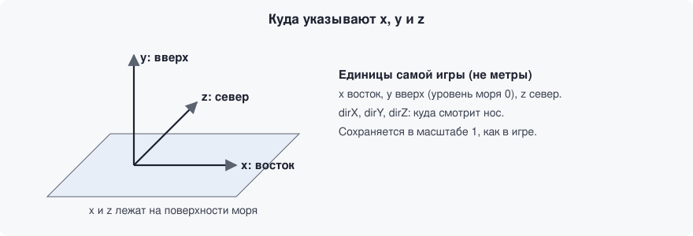

# Таблица {#the-table}

Одна строка на выборку или событие, в `<match>.parquet`: 31 столбец
([Список столбцов](../columns.md), создан из кода).

| Столбец | Что |
|---|---|
| `match`, `map` | id боя; карта (`spaces/99_testmap` на картинках) |
| `time` | секунды с начала записи (в них входит обратный отсчёт) |
| `battleTime` | секунды с начала боя; отрицательные во время обратного отсчёта |
| `event` | что означает строка (ниже) |
| `player`, `team`, `own` | имя игрока; `ally` или `enemy` относительно игрока, который записал реплей; `1` в строках самого игрока, который записал реплей |
| `vehicle`, `type` | корабль игрока, который записал реплей, по названию (`PASB018-Iowa-1944`), остальные — по номеру корабля в игре (`4253956080`), если только `--ship-names` не называет их; `battleship`, `cruiser`, `destroyer`, `aircraft carrier`, `submarine`, если это видно из названия, иначе `ship` |
| `x`, `y`, `z` | единицы мира игры: x — восток, y — вверх (уровень моря 0), z — север |
| `dirX`, `dirY`, `dirZ` | куда смотрит нос, единичный вектор в той же системе (`dirY` 0: только курс); у снаряда или торпеды — куда он пошёл |
| `other`, `reason` | другой корабль события (убийца, жертва, атакующий); номер причины игры для потопления (не назван), тип попадания для удара, канал для чата |
| `value`, `health` | число события (урон, скорость снаряда или торпеды в единицах мира в секунду); здоровье корабля после попадания |
| `text` | строка чата |
| `shot`, `params` | id залпа; тип снаряда или торпеды как номер параметра игры |
| `entity` | id корабля в реплее |
| `otherVehicle`, `otherType` | у `impact` по кораблю: этот корабль и его класс |
| `hitLocalX`, `hitLocalY`, `hitLocalZ` | у `impact` по кораблю: где снаряд закончился в собственной системе этого корабля, в метрах (единицы мира умножить на 15): x — вперёд, y — вверх от моря, z — вправо |
| `pitch`, `roll` | у положения — тангаж и крен корабля (радианы), как их присылает игра: корабль кренится на повороте |

| `event` | В чьей строке | Что |
|---|---|---|
| `position` | каждого корабля | пока клиент его видел |
| `death`, `kill` | жертвы, убийцы | каждое потопление дважды: где корабль затонул и где стоял его убийца |
| `hurt`, `damage` | жертвы, атакующего | попадание: `value` — урон, `health` — что осталось |
| `shot` | стрелявшего | по одной строке на снаряд, у орудия, в направлении, куда он полетел |
| `torpedo` | стрелявшего | по одной строке на торпеду, там, где её выпустили, в направлении, куда она пошла |
| `impact` | стрелявшего | где закончился снаряд (попадание, промах в воду, ...); `reason` — номер типа попадания; по кораблю (любой тип, кроме 0 — вода, 8, 32, 64 — суша, в пределах 6 единиц от корабля) `other`/`otherVehicle`/`otherType` — корабль и `hitLocalX/Y/Z` — точка в его системе (см. выше) |
| `chat` | отправителя | `text` — строка, `reason` — канал (`battle_team`, `battle_common`) |

**Единицы.** Единица мира — это не метр. Линкор на ходу проходит около 2.4 единицы в секунду, а
карта имеет около 1 200 в поперечнике. По геометрии корпусов кораблей единица равна 15 м; собственные
цифры дальностей игры делают её 30 м (landaire/wows-toolkit, `crates/wows-core/src/units.rs`, MIT,
который оставляет эти два значения несогласованными). Таблица хранит единицы мира с масштабом 1, как
каждый источник 3DHeat хранит собственные единицы игры, поэтому уровень, экспортированный в тех же
единицах, совпадает с ней. Подсказки в подвале `heat3d`: y вверх, z перевёрнуто (поэтому карта не
отражена), корабль длиной 12 единиц, `player` — как человек, `team` — как группа, `match` — как сессия.

---

Часть [3DHeat](https://github.com/Holdi601/3DHeat) ([документация](https://holdi601.github.io/3DHeat/)). Исходный код: [3DHeat-Ext-WoWs](https://github.com/Holdi601/3DHeat-Ext-WoWs).
