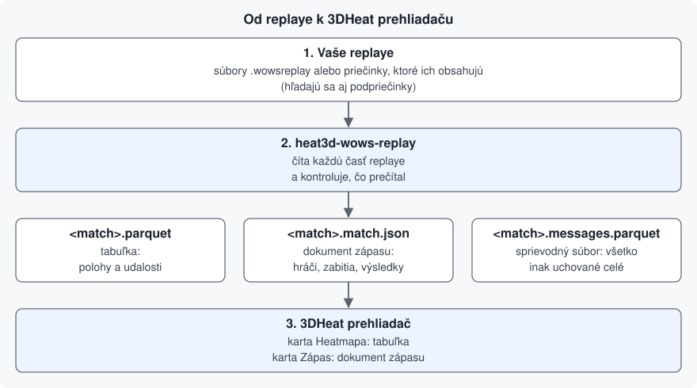

# 3DHeat replaye z World of Warships {#dheat-world-of-warships-replays}

**Čo to je?** World of Warships dokáže uložiť každú bitku, ktorú odohráte, ako súbor replaye. Tento nástroj
premení tieto súbory na tabuľku a dokument zápasu (súhrn bitky), ktoré
[3DHeat prehliadač](https://holdi601.github.io/3DHeat/) zobrazí v 3D: kam plávala každá loď,
kde strieľala a kde bola zasiahnutá.

**Prečo by som to používal?** Aby ste si bitku znova pozreli zhora, všetky lode naraz; aby ste videli
heatmapy toho, kde vy aj ostatní plavíte, bojujete a potápate sa počas stoviek bitiek; aby ste videli, kam
dopadli granáty a torpéda; alebo aby ste replay čítali vlastnými skriptami, lebo výstup je obyčajný Parquet a JSON.

**Príklad:** jeden súbor replaye na vstupe, tabuľka a dokument zápasu na výstupe:



## Rýchly štart {#quick-start}

Ste noví v príkazovom riadku? Najskôr si prečítajte [Než začnete](before-you-start.md).

```bash
git clone https://github.com/Holdi601/3DHeat-Ext-WoWs.git
cd 3DHeat-Ext-WoWs
pip install -e .
heat3d-wows-replay "<World of Warships>/replays" -o out
```

Uvidíte jeden riadok na každý replay, končiaci súborom, ktorý zapísal:
`... -> out/<map>/<match>.parquet`. Otvorte tento súbor a vedľa neho
`<match>.match.json` v 3DHeat prehliadači.

## Táto dokumentácia {#this-documentation}

| Stránka | Čo obsahuje |
|---|---|
| [Než začnete](before-you-start.md) | Python, terminál a to, ako vyzerá úspech |
| [Inštalácia](installing.md) | inštalácia, kontrola, aktualizácie |
| [Konverzia replayov](converting.md) | krok za krokom, každá možnosť, správy, návratový stav |
| [Tabuľka](table.md) | každý stĺpec a každá udalosť v `<match>.parquet` |
| [Dokument zápasu](match-document.md) | každý kľúč v `<match>.match.json` |
| [Ako sa replay číta](how-it-reads.md) | formát a to, ako sa čítanie overilo |
| [Úplnosť](completeness.md) | sprievodný súbor a samokontrola |
| [Podmienky a licencia](terms.md) | čo číta, licencia, zdroje |
| [Referencia príkazov](../cli-reference.md), [Zoznam stĺpcov](../columns.md) | generované z kódu |

## Súčasť 3DHeat {#part-of-3dheat}

Tento konvertor je jedným z nástrojov [3DHeat](https://github.com/Holdi601/3DHeat),
prehliadača 3D telemetrie a replayov v reálnom čase ([dokumentácia](https://holdi601.github.io/3DHeat/)).
Prehliadač otvorí tabuľku na karte Heatmapa a dokument zápasu na karte Zápas. Dokáže
súbory jedného zápasu zabaliť do jedného súboru:
[Jeden súbor na zápas](https://holdi601.github.io/3DHeat/container.html). Čo musí každý
konvertor zachovať: [Konvertory zachovávajú všetko](https://holdi601.github.io/3DHeat/converters.html).

Každá čítačka hry je samostatný malý projekt s vlastným súborom licencie,
vydaniami a evidenciou problémov, takže ju možno inštalovať, aktualizovať,
udržiavať - alebo na žiadosť držiteľa práv stiahnuť - samostatne, bez vplyvu
na prehliadač a ostatné nástroje. Watcher tento konvertor spúšťa, keď je
nainštalovaný, a funguje aj bez neho. Čo konvertor číta: [Podmienky a
licencia](terms.md).

| Nástroj | Čo robí | Zdroj | Dokumentácia |
|---|---|---|---|
| 3DHeat prehliadač | zobrazuje údaje v 3D: heatmapy, replaye, analýzu závodov | [3DHeat](https://github.com/Holdi601/3DHeat) | [stránka](https://holdi601.github.io/3DHeat/) |
| GameFiles | trate a levely zo súborov, ktoré hry obsahujú | [3DHeat-GameFiles](https://github.com/Holdi601/3DHeat-GameFiles) | [stránka](https://holdi601.github.io/3DHeat-GameFiles/) |
| GameCapture | telemetria kôl a levely zrekonštruované z videa hry | [3DHeat-GameCapture](https://github.com/Holdi601/3DHeat-GameCapture) | [stránka](https://holdi601.github.io/3DHeat-GameCapture/) |
| Unreal Exporter | plugin pre Unreal Editor, ktorý exportuje level | [3DHeat-UnrealExporter](https://github.com/Holdi601/3DHeat-UnrealExporter) | [stránka](https://holdi601.github.io/3DHeat-UnrealExporter/) |
| CS2 | dema a mapy Counter-Strike 2 | [3DHeat-CS2](https://github.com/Holdi601/3DHeat-CS2) | [stránka](https://holdi601.github.io/3DHeat-CS2/) |
| Watcher | zaznamenáva, čo hry zverejňujú počas hrania | [3DHeat-Watcher](https://github.com/Holdi601/3DHeat-Watcher) | [stránka](https://holdi601.github.io/3DHeat-Watcher/) |
| Replaye War Thunder | replaye `.wrpl` a levely War Thunder | [3DHeat-Ext-WarThunder](https://github.com/Holdi601/3DHeat-Ext-WarThunder) | [stránka](https://holdi601.github.io/3DHeat-Ext-WarThunder/) |
| Replaye World of Tanks | replaye `.wotreplay` | [3DHeat-Ext-WoT](https://github.com/Holdi601/3DHeat-Ext-WoT) | [stránka](https://holdi601.github.io/3DHeat-Ext-WoT/) |
| Replaye World of Warships | replaye `.wowsreplay` | [3DHeat-Ext-WoWs](https://github.com/Holdi601/3DHeat-Ext-WoWs) | [stránka](https://holdi601.github.io/3DHeat-Ext-WoWs/) |
| Dema Squad | dema zo serverov Squad | [3DHeat-Ext-Squad](https://github.com/Holdi601/3DHeat-Ext-Squad) | [stránka](https://holdi601.github.io/3DHeat-Ext-Squad/) |
| Mapy DCS | mapy DCS World ako 3D levely | [3DHeat-Ext-DCS](https://github.com/Holdi601/3DHeat-Ext-DCS) | [stránka](https://holdi601.github.io/3DHeat-Ext-DCS/) |
| Mapy IL-2 | mapy IL-2 Great Battles ako 3D levely | [3DHeat-Ext-IL2](https://github.com/Holdi601/3DHeat-Ext-IL2) | [stránka](https://holdi601.github.io/3DHeat-Ext-IL2/) |

---

Zdroj: [3DHeat-Ext-WoWs](https://github.com/Holdi601/3DHeat-Ext-WoWs).
