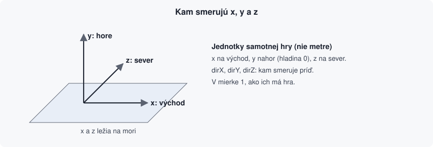

# Tabuľka {#the-table}

Jeden riadok na vzorku alebo udalosť, v `<match>.parquet`: 31 stĺpcov
([Zoznam stĺpcov](../columns.md), generovaný z kódu).

| Stĺpec | Čo |
|---|---|
| `match`, `map` | id bitky; mapa (`spaces/99_testmap` na obrázkoch) |
| `time` | sekundy od začiatku nahrávania (odpočítavanie je v nich zahrnuté) |
| `battleTime` | sekundy od začiatku bitky; záporné počas odpočítavania |
| `event` | čo riadok je (nižšie) |
| `player`, `team`, `own` | meno hráča; `ally` alebo `enemy` voči hráčovi, ktorý replay nahral; `1` na riadkoch hráča, ktorý replay nahral |
| `vehicle`, `type` | loď hráča, ktorý replay nahral, podľa názvu (`PASB018-Iowa-1944`), ostatné podľa čísla lode hry (`4253956080`), pokiaľ ich `--ship-names` nepomenuje; `battleship`, `cruiser`, `destroyer`, `aircraft carrier`, `submarine`, ak to názov hovorí, inak `ship` |
| `x`, `y`, `z` | jednotky sveta hry: x na východ, y nahor (hladina mora 0), z na sever |
| `dirX`, `dirY`, `dirZ` | kam smeruje príď, jednotkový vektor v tom istom systéme (`dirY` 0: len smer); pri granáte alebo torpédu, ako letelo |
| `other`, `reason` | druhá loď udalosti (vrah, obeť, útočník); číslo príčiny potopenia podľa hry (nepomenované), typ zásahu pri dopade, kanál pri chate |
| `value`, `health` | číslo udalosti (poškodenie, rýchlosť granátu alebo torpéda v jednotkách sveta za sekundu); zdravie lode po zásahu |
| `text` | riadok chatu |
| `shot`, `params` | id salvy; typ granátu alebo torpéda ako číslo parametra hry |
| `entity` | id lode v replaye |
| `otherVehicle`, `otherType` | pri `impact` na lodi: tá loď a jej trieda |
| `hitLocalX`, `hitLocalY`, `hitLocalZ` | pri `impact` na lodi: kde granát dopadol v súradniciach tej lode, v metroch (jednotky sveta krát 15): x dopredu, y nahor od hladiny, z doprava |
| `pitch`, `roll` | pri polohe sklon a náklon lode (radiány), tak, ako ich hra posiela: loď sa v zákrute nakláňa |

| `event` | Na riadku | Čo |
|---|---|---|
| `position` | každá loď | kým ju klient videl |
| `death`, `kill` | obeť, vrah | každé potopenie dvakrát: kde loď klesla a kde bol jej vrah |
| `hurt`, `damage` | obeť, útočník | zásah: `value` poškodenie, `health` čo zostalo |
| `shot` | strelec | jeden riadok na granát, pri dele, v smere, ktorým letel |
| `torpedo` | strelec | jeden riadok na torpédo, kde bolo vypustené, v smere, ktorým išlo |
| `impact` | strelec | kde granát dopadol (zásah, minutie do vody, ...); `reason` číslo typu zásahu; na lodi (akéhokoľvek typu okrem 0 voda, 8, 32, 64 pevnina, do 6 jednotiek od lode) `other`/`otherVehicle`/`otherType` loď a `hitLocalX/Y/Z` bod v jej súradniciach (vyššie) |
| `chat` | odosielateľ | `text` riadok, `reason` kanál (`battle_team`, `battle_common`) |

**Jednotky.** Jednotka sveta nie je meter. Bojová loď pri plnej rýchlosti prejde asi 2,4
z nich za sekundu a mapa má asi 1 200 napríč. Porovnaná s geometriou trupov lodí je jednotka 15 m;
vzdialenosti dostrelu hry ju robia 30 m (landaire/wows-toolkit, `crates/wows-core/src/units.rs`, MIT, ktorý
obe hodnoty nezmieril). Tabuľka drží jednotky sveta v mierke 1, ako každý zdroj 3DHeat drží vlastné jednotky
hry, takže level exportovaný v tých istých jednotkách sedí. Nápovedy v päte: Y nahor, Z otočené (aby mapa
nebola zrkadlová), loď dlhá 12 jednotiek, `player` ako osoba, `team` ako skupina, `match` ako relácia.

---

Súčasť [3DHeat](https://github.com/Holdi601/3DHeat) ([dokumentácia](https://holdi601.github.io/3DHeat/)). Zdroj: [3DHeat-Ext-WoWs](https://github.com/Holdi601/3DHeat-Ext-WoWs).
