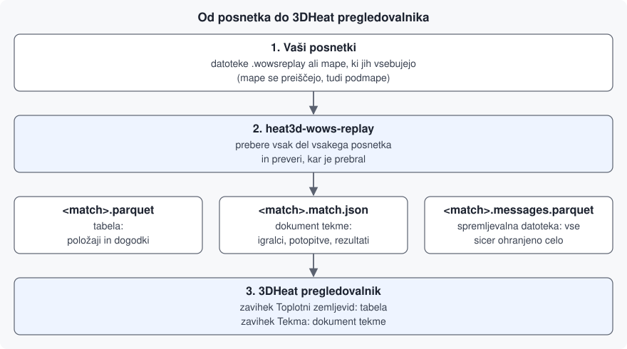

# 3DHeat posnetki iz World of Warships {#dheat-world-of-warships-replays}

**Kaj je to?** World of Warships lahko shrani vsako bitko, ki jo igrate, kot datoteko s posnetkom. To orodje
te datoteke pretvori v tabelo in dokument tekme (povzetek bitke), ki ju
[3DHeat pregledovalnik](https://holdi601.github.io/3DHeat/) prikaže v 3D: kam je plula vsaka
ladja, kje je streljala in kje je bila zadeta.

**Zakaj bi to uporabljal?** Da bitko ponovno pogledaš od zgoraj, vse ladje naenkrat; da vidiš toplotne
zemljevide, kje ti in drugi plujete, se borite in potapljate v stotinah bitk; da vidiš, kam so šli
izstrelki in torpedi; ali da posnetek bereš s svojimi skripti, saj je izhod navaden Parquet in JSON.

**Primer:** ena datoteka posnetka na vhodu, tabela in dokument tekme na izhodu:



## Hitri začetek {#quick-start}

Ste novi v ukazni vrstici? Najprej preberite [Preden začnete](before-you-start.md).

```bash
git clone https://github.com/Holdi601/3DHeat-Ext-WoWs.git
cd 3DHeat-Ext-WoWs
pip install -e .
heat3d-wows-replay "<World of Warships>/replays" -o out
```

Videli boste eno vrstico za vsak posnetek, ki se konča z datoteko, ki jo je zapisal:
`... -> out/<map>/<match>.parquet`. Odprite to datoteko in poleg nje `<match>.match.json` v
3DHeat pregledovalniku.

## Ta dokumentacija {#this-documentation}

| Stran | Kaj obravnava |
|---|---|
| [Preden začnete](before-you-start.md) | Python, ukazna vrstica in kako izgleda uspeh |
| [Namestitev](installing.md) | namestitev, preverjanje, posodobitve |
| [Pretvorba posnetkov](converting.md) | korak za korakom, vsaka možnost, sporočila, končno stanje |
| [Tabela](table.md) | vsak stolpec in dogodek v `<match>.parquet` |
| [Dokument tekme](match-document.md) | vsak ključ v `<match>.match.json` |
| [Kako bere posnetek](how-it-reads.md) | format in kako je bilo branje preverjeno |
| [Popolnost](completeness.md) | spremljevalna datoteka in samopreverjanje |
| [Pogoji in licenca](terms.md) | pogoji Wargaminga, licenca, viri |
| [Referenca ukazov](../cli-reference.md), [Seznam stolpcev](../columns.md) | ustvarjeno iz kode |

## Del 3DHeat {#part-of-3dheat}

Ta pretvornik je eno od orodij [3DHeat](https://github.com/Holdi601/3DHeat), pregledovalnika telemetrije in
posnetkov v realnem času v 3D ([dokumentacija](https://holdi601.github.io/3DHeat/)). Pregledovalnik odpre
tabelo na zavihku Toplotni zemljevid in dokument tekme na zavihku Tekma. Lahko zapakira datoteke tekme v
eno datoteko: [Ena datoteka za tekmo](https://holdi601.github.io/3DHeat/container.html). Kaj mora vsak
pretvornik ohraniti: [Pretvorniki ohranijo vse](https://holdi601.github.io/3DHeat/converters.html).

Pretvornik je namenoma ločen od 3DHeat Watcherja: posnetki so šifrirani, pogoji Wargaminga pa so široki
([Pogoji in licenca](terms.md)). Če ga bo treba odstraniti, z njim ne odide nič drugega. Watcher ga zažene,
kadar je nameščen, in deluje tudi brez njega.

| Orodje | Kaj počne | Vir | Dokumentacija |
|---|---|---|---|
| 3DHeat pregledovalnik | prikaz podatkov v 3D: toplotni zemljevidi, posnetki, analiza dirk | [3DHeat](https://github.com/Holdi601/3DHeat) | [spletna stran](https://holdi601.github.io/3DHeat/) |
| GameFiles | poti in zemljevidi iz datotek, ki jih igre prinašajo | [3DHeat-GameFiles](https://github.com/Holdi601/3DHeat-GameFiles) | [spletna stran](https://holdi601.github.io/3DHeat-GameFiles/) |
| GameCapture | telemetrija krogov in zemljevidi, obnovljeni iz posnetkov igre | [3DHeat-GameCapture](https://github.com/Holdi601/3DHeat-GameCapture) | [spletna stran](https://holdi601.github.io/3DHeat-GameCapture/) |
| Unreal Exporter | vtičnik za Unreal Editor, ki izvozi zemljevid | [3DHeat-UnrealExporter](https://github.com/Holdi601/3DHeat-UnrealExporter) | [spletna stran](https://holdi601.github.io/3DHeat-UnrealExporter/) |
| CS2 | demonstracije in zemljevidi za Counter-Strike 2 | [3DHeat-CS2](https://github.com/Holdi601/3DHeat-CS2) | [spletna stran](https://holdi601.github.io/3DHeat-CS2/) |
| Watcher | beleži, kar igre objavijo med igranjem | [3DHeat-Watcher](https://github.com/Holdi601/3DHeat-Watcher) | [spletna stran](https://holdi601.github.io/3DHeat-Watcher/) |
| Posnetki War Thunder | posnetki `.wrpl` in zemljevidi War Thunder | [3DHeat-Ext-WarThunder](https://github.com/Holdi601/3DHeat-Ext-WarThunder) | [spletna stran](https://holdi601.github.io/3DHeat-Ext-WarThunder/) |
| Posnetki World of Tanks | posnetki `.wotreplay` | [3DHeat-Ext-WoT](https://github.com/Holdi601/3DHeat-Ext-WoT) | [spletna stran](https://holdi601.github.io/3DHeat-Ext-WoT/) |
| Posnetki World of Warships | posnetki `.wowsreplay` | [3DHeat-Ext-WoWs](https://github.com/Holdi601/3DHeat-Ext-WoWs) | [spletna stran](https://holdi601.github.io/3DHeat-Ext-WoWs/) |
| Demonstracije Squad | demonstracije strežnika Squad | [3DHeat-Ext-Squad](https://github.com/Holdi601/3DHeat-Ext-Squad) | [spletna stran](https://holdi601.github.io/3DHeat-Ext-Squad/) |
| Zemljevidi DCS | zemljevidi DCS World kot 3D zemljevidi | [3DHeat-Ext-DCS](https://github.com/Holdi601/3DHeat-Ext-DCS) | [spletna stran](https://holdi601.github.io/3DHeat-Ext-DCS/) |
| Zemljevidi IL-2 | zemljevidi IL-2 Great Battles kot 3D zemljevidi | [3DHeat-Ext-IL2](https://github.com/Holdi601/3DHeat-Ext-IL2) | [spletna stran](https://holdi601.github.io/3DHeat-Ext-IL2/) |

---

Vir: [3DHeat-Ext-WoWs](https://github.com/Holdi601/3DHeat-Ext-WoWs).
