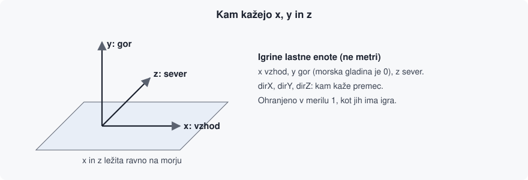

# Tabela {#the-table}

Ena vrstica na vzorec ali dogodek, v `<match>.parquet`: 31 stolpcev ([Seznam stolpcev](../columns.md), ustvarjen iz kode).

| Stolpec | Kaj |
|---|---|
| `match`, `map` | identifikator bitke; zemljevid (`spaces/99_testmap` na slikah) |
| `time` | sekunde od začetka snemanja (odštevanje je vključeno) |
| `battleTime` | sekunde od začetka bitke; negativno med odštevanjem |
| `event` | vrsta vrstice (spodaj) |
| `player`, `team`, `own` | ime igralca; `ally` ali `enemy` igralca, ki je snemal; `1` na vrsticah igralca, ki je snemal |
| `vehicle`, `type` | ladja igralca, ki je snemal, po imenu (`PASB018-Iowa-1944`), druge po igrini številki ladje (`4253956080`), razen če jih `--ship-names` poimenuje; `battleship`, `cruiser`, `destroyer`, `aircraft carrier`, `submarine`, kadar to pove ime, sicer `ship` |
| `x`, `y`, `z` | igrine svetovne enote: x vzhod, y gor (morska gladina 0), z sever |
| `dirX`, `dirY`, `dirZ` | kamor kaže premec, enotski vektor v istem okviru (`dirY` 0: samo smer); pri izstrelku ali torpedu pot, po kateri je šel |
| `other`, `reason` | druga ladja dogodka (ubijalec, žrtev, napadalec); igrina številka vzroka za potopitev (ni poimenovana), vrsta zadetka pri udarcu, kanal pri klepetu |
| `value`, `health` | število dogodka (škoda, hitrost izstrelka ali torpeda v svetovnih enotah na sekundo); zdravje ladje po zadetku |
| `text` | vrstica klepeta |
| `shot`, `params` | identifikator salva; vrsta izstrelka ali torpeda, kot igrina številka parametra |
| `entity` | id ladje v posnetku |
| `otherVehicle`, `otherType` | pri `impact` na ladji: ta ladja in njen razred |
| `hitLocalX`, `hitLocalY`, `hitLocalZ` | pri `impact` na ladji: kje je izstrelek končal v okviru te ladje, v metrih (svetovne enote krat 15): x naprej, y gor od morja, z desno |
| `pitch`, `roll` | pri položaju naklon in zvitek ladje (radiani), kot ju pošilja igra: ladja se nagiba v zavoju |

| `event` | Na vrstici | Kaj |
|---|---|---|
| `position` | vsaka ladja | medtem ko jo je odjemalec videl |
| `death`, `kill` | žrtev, ubijalec | vsaka potopitev dvakrat: kje je ladja potonila in kje je bil njen ubijalec |
| `hurt`, `damage` | žrtev, napadalec | zadetek: `value` škoda, `health` kar je ostalo |
| `shot` | strelec | ena vrstica na izstrelek, na topu, v smeri, v kateri je letel |
| `torpedo` | strelec | ena vrstica na torpedo, kjer je bil izstreljen, v smeri, v kateri je tekel |
| `impact` | strelec | kje je izstrelek končal (zadetek, zgrešitev v vodo, ...); `reason` številka vrste zadetka; na ladji (katerikoli tip razen 0 voda, 8, 32, 64 kopno, znotraj 6 enot od ladje) `other`/`otherVehicle`/`otherType` ladja in `hitLocalX/Y/Z` točka v njenem okviru (zgoraj) |
| `chat` | pošiljatelj | `text` vrstica, `reason` kanal (`battle_team`, `battle_common`) |

**Enote.** Svetovna enota ni meter. Bojna ladja pri hitrosti prevozi približno 2,4 enote na sekundo, zemljevid pa je
širok približno 1.200. Glede na geometrijo trupov ladij je enota 15 m; igrine lastne številke dosegov jo naredijo za 30 m
(landaire/wows-toolkit, `crates/wows-core/src/units.rs`, MIT, ti dve vrednosti se ne ujemata). Tabela hrani svetovne enote v merilu 1,
kot vsak vir 3DHeat hrani svoje igrine enote, zato se zemljevid, izvožen v istih enotah, poravna. Namigi v nogi `heat3d`:
y gor, z obrnjen (zato zemljevid ni zrcaljen), ladja dolga 12 enot, `player` kot oseba, `team` kot skupina, `match` kot
seja.

---

Del [3DHeat](https://github.com/Holdi601/3DHeat) ([dokumentacija](https://holdi601.github.io/3DHeat/)). Vir: [3DHeat-Ext-WoWs](https://github.com/Holdi601/3DHeat-Ext-WoWs).
