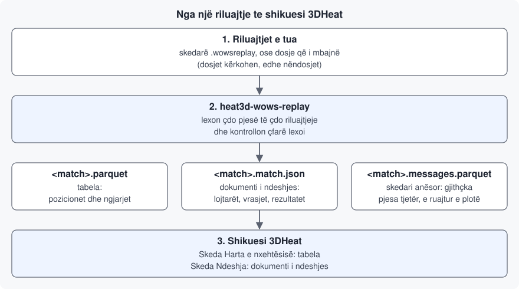

# Riluajtjet e World of Warships për 3DHeat {#dheat-world-of-warships-replays}

**Çfarë është?** World of Warships mund ta ruajë çdo betejë që luan si skedar
riluajtjeje. Ky mjet i kthen ato skedarë në një tabelë dhe një dokument ndeshjeje (përmbledhjen e
betejës) që [shikuesi 3DHeat](https://holdi601.github.io/3DHeat/) e shfaq në 3D: ku
ka lundruar, gjuajtur dhe është goditur çdo anije.

**Pse do ta përdorja?** Për ta parë një betejë sërish nga lart, me çdo anije
njëkohësisht; për të parë harta nxehtësie të vendeve ku ti dhe të tjerët lundroni, luftoni dhe fundoseni gjatë
qindra betejave; për të parë ku shkuan predhat dhe silurët; ose për ta lexuar një riluajtje me skriptet e tua, pasi
rezultati është Parquet dhe JSON i thjeshtë.

**Shembull:** një skedar riluajtjeje hyn, një tabelë dhe një dokument ndeshjeje dalin:



## Fillimi i shpejtë {#quick-start}

Je i ri me rreshtin e komandave? Lexo së pari [Para se të fillosh](before-you-start.md).

```bash
git clone https://github.com/Holdi601/3DHeat-Ext-WoWs.git
cd 3DHeat-Ext-WoWs
pip install -e .
heat3d-wows-replay "<World of Warships>/replays" -o out
```

Duhet të shohësh një rresht për çdo riluajtje, që mbaron me skedarin që shkroi:
`... -> out/<map>/<match>.parquet`. Hape atë skedar dhe
`<match>.match.json` pranë tij në shikuesin 3DHeat.

## Ky dokumentacion {#this-documentation}

| Faqja | Çfarë përfshin |
|---|---|
| [Para se të fillosh](before-you-start.md) | Python, një terminal dhe si duket suksesi |
| [Instalimi](installing.md) | instalimi, kontrolli, përditësimet |
| [Konvertimi i riluajtjeve](converting.md) | hap pas hapi, çdo opsion, mesazhet, statusi i daljes |
| [Tabela](table.md) | çdo kolonë dhe ngjarje e `<match>.parquet` |
| [Dokumenti i ndeshjes](match-document.md) | çdo çelës i `<match>.match.json` |
| [Si e lexon një riluajtje](how-it-reads.md) | formati, dhe si u kontrollua leximi |
| [Plotësia](completeness.md) | skedari anësor dhe vetëkontrolli |
| [Kushtet dhe licenca](terms.md) | çfarë lexon, licenca, burimet |
| [Referenca e komandave](../cli-reference.md), [Lista e kolonave](../columns.md) | e gjeneruar nga kodi |

## Pjesë e 3DHeat {#part-of-3dheat}

Ky konvertues është një nga mjetet e [3DHeat](https://github.com/Holdi601/3DHeat),
një shikues telemetrie dhe riluajtjesh 3D në kohë reale ([dokumentacioni](https://holdi601.github.io/3DHeat/)).
Shikuesi e hap tabelën në skedën e tij Harta e nxehtësisë dhe dokumentin e ndeshjes në skedën e tij
Ndeshja. Mund t'i paketojë skedarët e një ndeshjeje në një skedar të vetëm:
[Një skedar për ndeshje](https://holdi601.github.io/3DHeat/container.html). Çfarë duhet të ruajë çdo
konvertues: [Konvertuesit ruajnë gjithçka](https://holdi601.github.io/3DHeat/converters.html).

Çdo lexues loje është një projekt i vogël më vete, me skedarin e vet të
licencës, versionet e veta dhe gjurmuesin e vet të problemeve, kështu që mund
të instalohet, përditësohet, mirëmbahet - ose tërhiqet me kërkesë të një
mbajtësi të drejtash - më vete, pa prekur shikuesin ose mjetet e tjera.
Watcher e ekzekuton këtë konvertues kur është i instaluar dhe punon edhe pa
të. Çfarë lexon konvertuesi: [Kushtet dhe licenca](terms.md).

| Mjeti | Çfarë bën | Burimi | Dokumentacioni |
|---|---|---|---|
| Shikuesi 3DHeat | i tregon të dhënat në 3D: harta nxehtësie, riluajtje, analizë gare | [3DHeat](https://github.com/Holdi601/3DHeat) | [faqja](https://holdi601.github.io/3DHeat/) |
| GameFiles | kurse dhe nivele nga skedarët që dërgojnë lojërat | [3DHeat-GameFiles](https://github.com/Holdi601/3DHeat-GameFiles) | [faqja](https://holdi601.github.io/3DHeat-GameFiles/) |
| GameCapture | telemetri xhiroje dhe nivele të rindërtuara nga video e lojës | [3DHeat-GameCapture](https://github.com/Holdi601/3DHeat-GameCapture) | [faqja](https://holdi601.github.io/3DHeat-GameCapture/) |
| Unreal Exporter | një shtojcë e Unreal Editor që eksporton një nivel | [3DHeat-UnrealExporter](https://github.com/Holdi601/3DHeat-UnrealExporter) | [faqja](https://holdi601.github.io/3DHeat-UnrealExporter/) |
| CS2 | demot dhe hartat e Counter-Strike 2 | [3DHeat-CS2](https://github.com/Holdi601/3DHeat-CS2) | [faqja](https://holdi601.github.io/3DHeat-CS2/) |
| Watcher | regjistron çfarë publikojnë lojërat ndërsa luan | [3DHeat-Watcher](https://github.com/Holdi601/3DHeat-Watcher) | [faqja](https://holdi601.github.io/3DHeat-Watcher/) |
| Riluajtjet e War Thunder | riluajtjet `.wrpl` dhe nivelet e War Thunder | [3DHeat-Ext-WarThunder](https://github.com/Holdi601/3DHeat-Ext-WarThunder) | [faqja](https://holdi601.github.io/3DHeat-Ext-WarThunder/) |
| Riluajtjet e World of Tanks | riluajtjet `.wotreplay` | [3DHeat-Ext-WoT](https://github.com/Holdi601/3DHeat-Ext-WoT) | [faqja](https://holdi601.github.io/3DHeat-Ext-WoT/) |
| Riluajtjet e World of Warships | riluajtjet `.wowsreplay` | [3DHeat-Ext-WoWs](https://github.com/Holdi601/3DHeat-Ext-WoWs) | [faqja](https://holdi601.github.io/3DHeat-Ext-WoWs/) |
| Demot e Squad | demot e serverit të Squad | [3DHeat-Ext-Squad](https://github.com/Holdi601/3DHeat-Ext-Squad) | [faqja](https://holdi601.github.io/3DHeat-Ext-Squad/) |
| Hartat e DCS | hartat e DCS World si nivele 3D | [3DHeat-Ext-DCS](https://github.com/Holdi601/3DHeat-Ext-DCS) | [faqja](https://holdi601.github.io/3DHeat-Ext-DCS/) |
| Hartat e IL-2 | hartat e IL-2 Great Battles si nivele 3D | [3DHeat-Ext-IL2](https://github.com/Holdi601/3DHeat-Ext-IL2) | [faqja](https://holdi601.github.io/3DHeat-Ext-IL2/) |

---

Burimi: [3DHeat-Ext-WoWs](https://github.com/Holdi601/3DHeat-Ext-WoWs).
