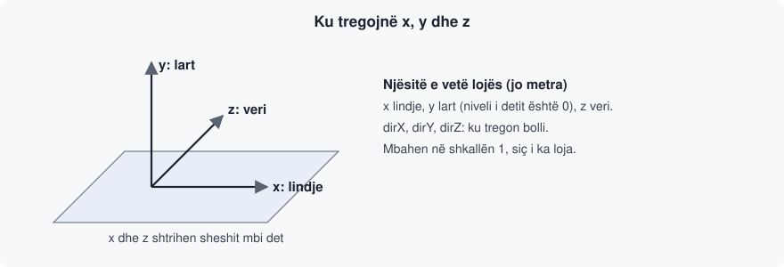

# Tabela {#the-table}

Një rresht për çdo mostër ose ngjarje, te `<match>.parquet`: 31 kolona
([Lista e kolonave](../columns.md), e gjeneruar nga kodi).

| Kolona | Çfarë |
|---|---|
| `match`, `map` | ID e betejës; harta (`spaces/99_testmap` në pamjet) |
| `time` | sekonda që nga fillimi i regjistrimit (numërimi mbrapsht është brenda) |
| `battleTime` | sekonda që nga fillimi i betejës; negative gjatë numërimit mbrapsht |
| `event` | çfarë është rreshti (më poshtë) |
| `player`, `team`, `own` | emri i lojtarit; `ally` ose `enemy` i lojtarit që regjistron; `1` në rreshtat e lojtarit që regjistron |
| `vehicle`, `type` | anija e lojtarit që regjistron me emër (`PASB018-Iowa-1944`), të tjerat sipas numrit të anijes në lojë (`4253956080`) përveç nëse `--ship-names` i emërton; `battleship`, `cruiser`, `destroyer`, `aircraft carrier`, `submarine` aty ku e thotë emri, përndryshe `ship` |
| `x`, `y`, `z` | njësitë botërore të lojës: x lindje, y lart (niveli i detit 0), z veri |
| `dirX`, `dirY`, `dirZ` | ku tregon maja e përparme e anijes, një vektor njësi në të njëjtin kuadër (`dirY` 0: vetëm heading); në një predhë ose silur, drejtimi ku shkoi |
| `other`, `reason` | anija tjetër e një ngjarjeje (vrasësi, viktima, sulmuesi); numri i shkakut të lojës për një fundosje (i paemërtuar), lloji i goditjes për një impact, kanali për bisedën |
| `value`, `health` | numri i ngjarjes (dëmi, shpejtësia e një predhe ose silurit në njësi botërore në sekondë); shëndeti i anijes pas një goditjeje |
| `text` | një rresht bisede |
| `shot`, `params` | ID e një breshërie; lloji i predhës ose silurit, si numri i parametrit të lojës |
| `entity` | ID e anijes në riluajtje |
| `otherVehicle`, `otherType` | në një `impact` mbi një anije: ajo anije dhe klasa e saj |
| `hitLocalX`, `hitLocalY`, `hitLocalZ` | në një `impact` mbi një anije: ku mbaroi predha në kuadrin e vetë asaj anijeje, në metra (njësi botërore herë 15): x përpara, y lart nga deti, z djathtas |
| `pitch`, `roll` | në një pozicion, pitch dhe roll i anijes (radianë) siç i dërgon loja: një anije anohet në kthesë |

| `event` | Në rreshtin e | Çfarë |
|---|---|---|
| `position` | çdo anijeje | ndërsa klienti e shihte |
| `death`, `kill` | viktimës, vrasësit | çdo fundosje dy herë: ku u fundos anija, dhe ku ishte vrasësi i saj |
| `hurt`, `damage` | viktimës, sulmuesit | një goditje: `value` dëmi, `health` çfarë mbetet |
| `shot` | gjuajtësit | një rresht për predhë, te topi, në drejtimin ku fluturoi |
| `torpedo` | gjuajtësit | një rresht për silur, ku u lëshua, në drejtimin ku shkoi |
| `impact` | gjuajtësit | ku mbaroi një predhë (goditi, humbi në ujë, ...); `reason` numri i llojit të goditjes; mbi një anije (çdo lloj përveç 0 ujë, 8, 32, 64 tokë, brenda 6 njësive nga një anije) `other`/`otherVehicle`/`otherType` anija dhe `hitLocalX/Y/Z` pika në kuadrin e saj (më sipër) |
| `chat` | dërguesit | `text` rreshti, `reason` kanali (`battle_team`, `battle_common`) |

**Njësitë.** Një njësi botërore nuk është një metër. Një luftanije me shpejtësi përshkon rreth 2.4
prej tyre në sekondë, dhe një hartë është rreth 1,200 e gjerë. Krahasuar me
gjeometrinë e trupave të anijeve, një njësi është 15 m; shifrat e vetë lojës për rrezet e bëjnë 30 m
(landaire/wows-toolkit, `crates/wows-core/src/units.rs`, MIT, që i lë të
dyja të pajtuara). Tabela i mban njësitë botërore në shkallën 1, siç e mban çdo burim 3DHeat
njësitë e vetë lojës së tij, kështu që një nivel i eksportuar në të njëjtat njësi
puthitet. Udhëzimet `heat3d` të fundit: Y lart, Z i kthyer (që harta të mos jetë pasqyruar),
një anije 12 njësi e gjatë, `player` si personi, `team` si grupi, `match` si
sesioni.

---

Pjesë e [3DHeat](https://github.com/Holdi601/3DHeat) ([dokumentacioni](https://holdi601.github.io/3DHeat/)). Burimi: [3DHeat-Ext-WoWs](https://github.com/Holdi601/3DHeat-Ext-WoWs).
