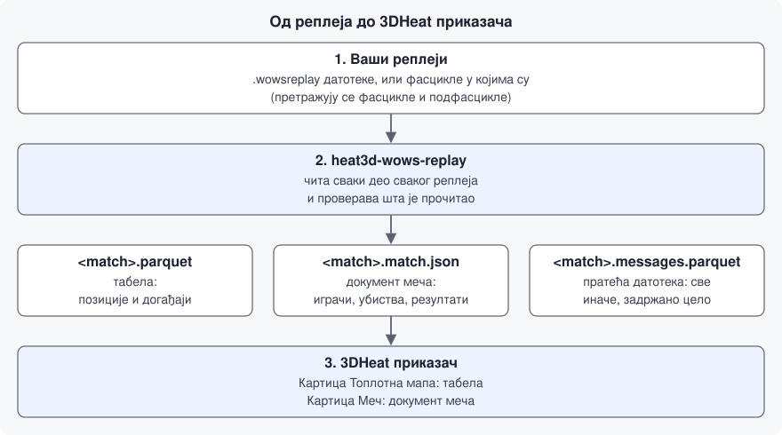

# 3DHeat реплеји World of Warships {#dheat-world-of-warships-replays}

**Шта је то?** World of Warships може да сачува сваку битку коју одиграте као
датотеку реплеја. Ова алатка те датотеке претвара у табелу и документ меча
(резиме битке) који [3DHeat приказач](https://holdi601.github.io/3DHeat/)
приказује у 3D: где је сваки брод пловио, пуцао и био погођен.

**Зашто бисте га користили?** Да битку поново гледате одозго, сви бродови
одједном; да видите топлотне мапе где сте ви и други пловили, борили се и
потапали кроз стотине битака; да видите куда су зрна и торпеда отишла; или да
реплеј читате својим скриптама, јер је излаз обичан Parquet и JSON.

**Пример:** један реплеј на улазу, табела и документ меча на излазу:



## Брзи почетак {#quick-start}

Први пут у командној линији? Прво прочитајте [Пре почетка](before-you-start.md).

```bash
git clone https://github.com/Holdi601/3DHeat-Ext-WoWs.git
cd 3DHeat-Ext-WoWs
pip install -e .
heat3d-wows-replay "<World of Warships>/replays" -o out
```

Требало би да видите по један ред за сваки реплеј, а на крају датотеку коју је
записао: `... -> out/<map>/<match>.parquet`. Отворите ту датотеку и
`<match>.match.json` поред ње у 3DHeat приказачу.

## Ова документација {#this-documentation}

| Страница | Шта обухвата |
|---|---|
| [Пре почетка](before-you-start.md) | Python, терминал и како изгледа успех |
| [Инсталација](installing.md) | инсталација, провера, ажурирања |
| [Претварање реплеја](converting.md) | корак по корак, свака опција, поруке, излазни статус |
| [Табела](table.md) | свака колона и догађај у `<match>.parquet` |
| [Документ меча](match-document.md) | сваки кључ у `<match>.match.json` |
| [Како чита реплеј](how-it-reads.md) | формат и како је читање проверено |
| [Потпуност](completeness.md) | пратећа датотека и самопровера |
| [Услови и лиценца](terms.md) | шта чита, лиценца, извори |
| [Референца команди](../cli-reference.md), [Списак колона](../columns.md) | генерисано из кода |

## Део 3DHeat-а {#part-of-3dheat}

Овај конвертор је једна од алатки [3DHeat](https://github.com/Holdi601/3DHeat),
приказача 3D телеметрије и реплеја у реалном времену
([документација](https://holdi601.github.io/3DHeat/)). Приказач табелу отвара
на картици Топлотна мапа, а документ меча на картици Меч. Може да спакује
датотеке једног меча у једну датотеку:
[Једна датотека по мечу](https://holdi601.github.io/3DHeat/container.html). Шта сваки
конвертор мора да задржи: [Конвертори задржавају све](https://holdi601.github.io/3DHeat/converters.html).

Сваки читач игре је засебан мали пројекат са сопственом датотеком лиценце,
издањима и системом за праћење проблема, па се може инсталирати, ажурирати,
одржавати - или повући на захтев носиоца права - засебно, без утицаја на
прегледач или друге алате. Watcher покреће овај конвертор када је инсталиран и
ради и без њега. Шта конвертор чита: [Услови и лиценца](terms.md).

| Алатка | Шта ради | Извор | Документација |
|---|---|---|---|
| 3DHeat приказач | приказује податке у 3D: топлотне мапе, реплеје, анализу трке | [3DHeat](https://github.com/Holdi601/3DHeat) | [сајт](https://holdi601.github.io/3DHeat/) |
| GameFiles | стазе и нивои из датотека које игре испоручују | [3DHeat-GameFiles](https://github.com/Holdi601/3DHeat-GameFiles) | [сајт](https://holdi601.github.io/3DHeat-GameFiles/) |
| GameCapture | телеметрија кола и нивои обновљени из снимака игре | [3DHeat-GameCapture](https://github.com/Holdi601/3DHeat-GameCapture) | [сајт](https://holdi601.github.io/3DHeat-GameCapture/) |
| Unreal Exporter | додатак за Unreal Editor који извози ниво | [3DHeat-UnrealExporter](https://github.com/Holdi601/3DHeat-UnrealExporter) | [сајт](https://holdi601.github.io/3DHeat-UnrealExporter/) |
| CS2 | Counter-Strike 2 демои и мапе | [3DHeat-CS2](https://github.com/Holdi601/3DHeat-CS2) | [сајт](https://holdi601.github.io/3DHeat-CS2/) |
| Watcher | бележи оно што игре објављују док играте | [3DHeat-Watcher](https://github.com/Holdi601/3DHeat-Watcher) | [сајт](https://holdi601.github.io/3DHeat-Watcher/) |
| War Thunder реплеји | `.wrpl` реплеји и нивои War Thunder-а | [3DHeat-Ext-WarThunder](https://github.com/Holdi601/3DHeat-Ext-WarThunder) | [сајт](https://holdi601.github.io/3DHeat-Ext-WarThunder/) |
| World of Tanks реплеји | `.wotreplay` реплеји | [3DHeat-Ext-WoT](https://github.com/Holdi601/3DHeat-Ext-WoT) | [сајт](https://holdi601.github.io/3DHeat-Ext-WoT/) |
| World of Warships реплеји | `.wowsreplay` реплеји | [3DHeat-Ext-WoWs](https://github.com/Holdi601/3DHeat-Ext-WoWs) | [сајт](https://holdi601.github.io/3DHeat-Ext-WoWs/) |
| Squad демои | демои Squad сервера | [3DHeat-Ext-Squad](https://github.com/Holdi601/3DHeat-Ext-Squad) | [сајт](https://holdi601.github.io/3DHeat-Ext-Squad/) |
| DCS мапе | мапе DCS World-а као 3D нивои | [3DHeat-Ext-DCS](https://github.com/Holdi601/3DHeat-Ext-DCS) | [сајт](https://holdi601.github.io/3DHeat-Ext-DCS/) |
| IL-2 мапе | мапе IL-2 Great Battles као 3D нивои | [3DHeat-Ext-IL2](https://github.com/Holdi601/3DHeat-Ext-IL2) | [сајт](https://holdi601.github.io/3DHeat-Ext-IL2/) |

---

Извор: [3DHeat-Ext-WoWs](https://github.com/Holdi601/3DHeat-Ext-WoWs).
