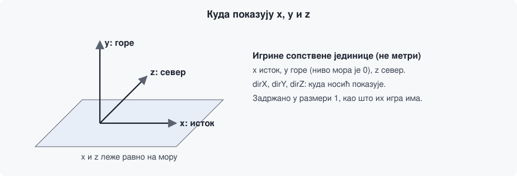

# Табела {#the-table}

Један ред по узорку или догађају, у `<match>.parquet`: 31 колона
([Списак колона](../columns.md), генерисано из кода).

| Колона | Шта је |
|---|---|
| `match`, `map` | ид битке; мапа (`spaces/99_testmap` на сликама) |
| `time` | секунде од почетка снимања (одбројавање је у њој) |
| `battleTime` | секунде од почетка битке; негативно за време одбројавања |
| `event` | шта ред представља (испод) |
| `player`, `team`, `own` | име играча; `ally` или `enemy` снимајућег играча; `1` у редовима снимајућег играча |
| `vehicle`, `type` | брод снимајућег играча по имену (`PASB018-Iowa-1944`), остали по игриним бројевима бродова (`4253956080`), осим ако их `--ship-names` не именује; `battleship`, `cruiser`, `destroyer`, `aircraft carrier`, `submarine` где то име казује, иначе `ship` |
| `x`, `y`, `z` | игрине јединице света: x исток, y горе (ниво мора 0), z север |
| `dirX`, `dirY`, `dirZ` | куда носић показује, јединични вектор у истом систему (`dirY` 0: само правац); код зрна или торпеда куда су ишли |
| `other`, `reason` | други брод у догађају (убица, жртва, нападач); игрин број узрока за потапање (није именован), врста поготка за удар, канал за ћаскање |
| `value`, `health` | број догађаја (штета, брзина зрна или торпеда у јединицама света у секунди); здравље брода после погодака |
| `text` | ред ћаскања |
| `shot`, `params` | ид салве; врста зрна или торпеда, као игрин број параметра |
| `entity` | ид брода у реплеју |
| `otherVehicle`, `otherType` | код `impact` на броду: тај брод и његова класа |
| `hitLocalX`, `hitLocalY`, `hitLocalZ` | код `impact` на броду: где је зрно стало у сопственом систему тог брода, у метрима (јединице света пута 15): x напред, y горе од мора, z десно |
| `pitch`, `roll` | на позицији, нагиб и валљање брода (радијани) онако како их игра шаље: брод нагиње у окрету |

| `event` | На реду | Шта је |
|---|---|---|
| `position` | сваког брода | док га је клијент видео |
| `death`, `kill` | жртве, убице | свако потапање два пута: где је брод потонуо, и где је била његова убица |
| `hurt`, `damage` | жртве, нападача | погодак: `value` штета, `health` шта је остало |
| `shot` | пуцача | по један ред за свако зрно, на топу, у правцу у ком је летело |
| `torpedo` | пуцача | по један ред за свако торпедо, где је испаљено, у правцу у ком је ишло |
| `impact` | пуцача | где је зрно стало (погодак, промашај у воду, ...); `reason` број врсте поготка; на броду (било које врсте осим 0 (вода), 8, 32 и 64 (копно), у 6 јединица од брода) `other`/`otherVehicle`/`otherType` брод и `hitLocalX/Y/Z` тачка у његовом систему (горе) |
| `chat` | пошиљаоца | `text` ред, `reason` канал (`battle_team`, `battle_common`) |

**Јединице.** Јединица света није метар. Бојни брод при брзини пређе око 2,4
од њих у секунди, а мапа је широка око 1.200. Упоређено с геометријом трупа
бродова, јединица је 15 m; игрини сопствени подаци о дометима дају 30 m
(landaire/wows-toolkit, `crates/wows-core/src/units.rs`, MIT, који их не
усаглашава). Табела чува јединице света у размери 1, као што сваки 3DHeat извор
чува сопствене јединице игре, па се ниво извезен у истим јединицама поклапа.
Наговештаји у подножју `heat3d`: Y горе, Z окренуто (да мапа не буде
огледална), брод дугачак 12 јединица, `player` као особа, `team` као група,
`match` као сесија.

---

Део [3DHeat](https://github.com/Holdi601/3DHeat) ([документација](https://holdi601.github.io/3DHeat/)). Извор: [3DHeat-Ext-WoWs](https://github.com/Holdi601/3DHeat-Ext-WoWs).
