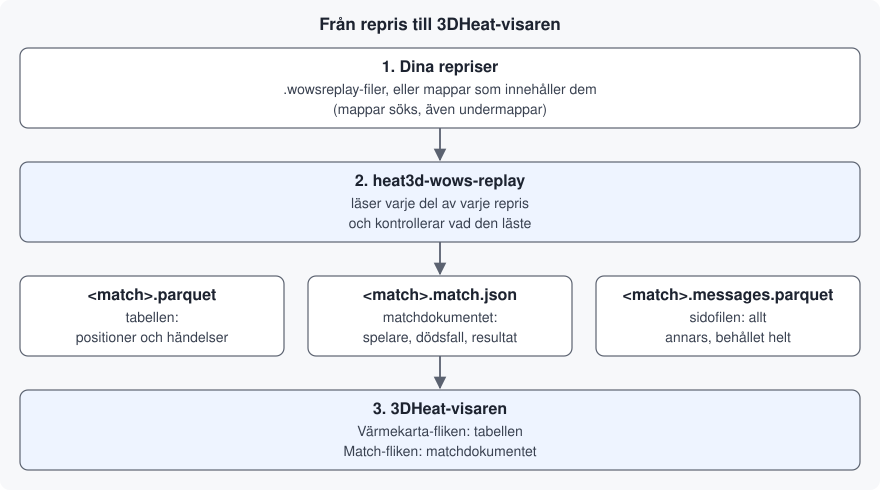

# 3DHeat World of Warships-repriser {#dheat-world-of-warships-replays}

**Vad är det?** World of Warships kan spara varje strid du spelar som en repris-fil.
Det här verktyget gör de filerna till en tabell och ett matchdokument (stridens
sammanfattning) som [3DHeat-visaren](https://holdi601.github.io/3DHeat/) visar i 3D: var
varje fartyg seglade, sköt och blev träffat.

**Varför skulle jag använda det?** För att se en strid igen uppifrån, alla fartyg på en
gång; för att se värmekartor över var du och andra seglar, slåss och sänker under hundratals
strider; för att se vart granater och torpeder tog vägen; eller för att läsa en repris med
egna skript, eftersom resultatet är vanlig Parquet och JSON.

**Exempel:** en repris-fil in, en tabell och ett matchdokument ut:



## Snabbstart {#quick-start}

Ny i kommandoraden? Läs [Innan du börjar](before-you-start.md) först.

```bash
git clone https://github.com/Holdi601/3DHeat-Ext-WoWs.git
cd 3DHeat-Ext-WoWs
pip install -e .
heat3d-wows-replay "<World of Warships>/replays" -o out
```

Du bör se en rad per repris, som slutar med filen den skrev:
`... -> out/<map>/<match>.parquet`. Öppna den filen och
`<match>.match.json` bredvid den i 3DHeat-visaren.

## Den här dokumentationen {#this-documentation}

| Sida | Vad den tar upp |
|---|---|
| [Innan du börjar](before-you-start.md) | Python, en terminal och hur lyckad körning ser ut |
| [Installera](installing.md) | installation, kontroll, uppdateringar |
| [Konvertera repriser](converting.md) | steg för steg, varje alternativ, meddelanden, exitstatus |
| [Tabellen](table.md) | varje kolumn och händelse i `<match>.parquet` |
| [Matchdokumentet](match-document.md) | varje nyckel i `<match>.match.json` |
| [Så läser den en repris](how-it-reads.md) | formatet, och hur läsningen kontrollerades |
| [Fullständighet](completeness.md) | sidofilen och självkontrollen |
| [Villkor och licens](terms.md) | Wargamings villkor, licens, källor |
| [Kommandoreferens](../cli-reference.md), [Kolumnlista](../columns.md) | genererade från koden |

## Del av 3DHeat {#part-of-3dheat}

Den här konverteraren är ett av verktygen i [3DHeat](https://github.com/Holdi601/3DHeat),
en realtidsvisare för 3D-telemetri och repriser ([dokumentation](https://holdi601.github.io/3DHeat/)).
Visaren öppnar tabellen på sin Värmekarta-flik och matchdokumentet på sin
Match-flik. Den kan packa en matchs filer till en fil:
[En fil per match](https://holdi601.github.io/3DHeat/container.html). Vad varje
konverterare måste behålla: [Konverterare behåller allt](https://holdi601.github.io/3DHeat/converters.html).

Konverteraren hålls avskild från 3DHeat Watcher med avsikt: repriserna är chifferskrivna, och
Wargamings villkor är breda ([Villkor och licens](terms.md)). Om den ändå måste bort, följer inget
annat med. Watcher kör den när den är installerad och fungerar utan den.

| Verktyg | Vad det gör | Källa | Dokumentation |
|---|---|---|---|
| 3DHeat-visaren | visar datan i 3D: värmekartor, repriser, loppanalys | [3DHeat](https://github.com/Holdi601/3DHeat) | [webbplats](https://holdi601.github.io/3DHeat/) |
| GameFiles | banor och nivåer ur filerna som spel levereras med | [3DHeat-GameFiles](https://github.com/Holdi601/3DHeat-GameFiles) | [webbplats](https://holdi601.github.io/3DHeat-GameFiles/) |
| GameCapture | varvtelemetri, och nivåer byggda från spelvideo | [3DHeat-GameCapture](https://github.com/Holdi601/3DHeat-GameCapture) | [webbplats](https://holdi601.github.io/3DHeat-GameCapture/) |
| Unreal Exporter | ett Unreal Editor-tillägg som exporterar en nivå | [3DHeat-UnrealExporter](https://github.com/Holdi601/3DHeat-UnrealExporter) | [webbplats](https://holdi601.github.io/3DHeat-UnrealExporter/) |
| CS2 | Counter-Strike 2-demos och banor | [3DHeat-CS2](https://github.com/Holdi601/3DHeat-CS2) | [webbplats](https://holdi601.github.io/3DHeat-CS2/) |
| Watcher | spelar in det spel publicerar medan du spelar | [3DHeat-Watcher](https://github.com/Holdi601/3DHeat-Watcher) | [webbplats](https://holdi601.github.io/3DHeat-Watcher/) |
| War Thunder-repriser | `.wrpl`-repriser och War Thunder-nivåer | [3DHeat-Ext-WarThunder](https://github.com/Holdi601/3DHeat-Ext-WarThunder) | [webbplats](https://holdi601.github.io/3DHeat-Ext-WarThunder/) |
| World of Tanks-repriser | `.wotreplay`-repriser | [3DHeat-Ext-WoT](https://github.com/Holdi601/3DHeat-Ext-WoT) | [webbplats](https://holdi601.github.io/3DHeat-Ext-WoT/) |
| World of Warships-repriser | `.wowsreplay`-repriser | [3DHeat-Ext-WoWs](https://github.com/Holdi601/3DHeat-Ext-WoWs) | [webbplats](https://holdi601.github.io/3DHeat-Ext-WoWs/) |
| Squad-demos | demos från Squad-servrar | [3DHeat-Ext-Squad](https://github.com/Holdi601/3DHeat-Ext-Squad) | [webbplats](https://holdi601.github.io/3DHeat-Ext-Squad/) |
| DCS-banor | DCS World-banor som 3D-nivåer | [3DHeat-Ext-DCS](https://github.com/Holdi601/3DHeat-Ext-DCS) | [webbplats](https://holdi601.github.io/3DHeat-Ext-DCS/) |
| IL-2-banor | IL-2 Great Battles-banor som 3D-nivåer | [3DHeat-Ext-IL2](https://github.com/Holdi601/3DHeat-Ext-IL2) | [webbplats](https://holdi601.github.io/3DHeat-Ext-IL2/) |

---

Källa: [3DHeat-Ext-WoWs](https://github.com/Holdi601/3DHeat-Ext-WoWs).
