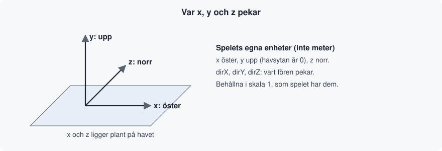

# Tabellen {#the-table}

En rad per mätpunkt eller händelse, i `<match>.parquet`: 31 kolumner
([Kolumnlista](../columns.md), genererad från koden).

| Kolumn | Vad |
|---|---|
| `match`, `map` | stridens id; kartan (`spaces/99_testmap` på bilderna) |
| `time` | sekunder sedan inspelningen började (nedräkningen ingår) |
| `battleTime` | sekunder sedan striden började; negativt under nedräkningen |
| `event` | vad raden är (nedan) |
| `player`, `team`, `own` | spelarens namn; `ally` eller `enemy` för den inspelande spelaren; `1` på den inspelande spelarens rader |
| `vehicle`, `type` | den inspelande spelarens fartyg med namn (`PASB018-Iowa-1944`), de andra med spelets fartygsnummer (`4253956080`) om inte `--ship-names` namnger dem; `battleship`, `cruiser`, `destroyer`, `aircraft carrier`, `submarine` där namnet säger det, annars `ship` |
| `x`, `y`, `z` | spelets världsenheter: x öster, y upp (havsytan 0), z norr |
| `dirX`, `dirY`, `dirZ` | vart fören pekar, en enhetsvektor i samma system (`dirY` 0: bara kurs); på en granat eller torped vägen den gick |
| `other`, `reason` | det andra fartyget i en händelse (dödare, offer, angripare); spelets orsaksnummer för en sänkning (inte namngivet), träfftypen för en nedslag, kanalen för chatt |
| `value`, `health` | händelsens tal (skada, en granats eller torpeds hastighet i världsenheter per sekund); fartygets hälsa efter en träff |
| `text` | en chattrad |
| `shot`, `params` | en salvas id; granatens eller torpedens typ, som spelets parameternummer |
| `entity` | fartygets id i repriset |
| `otherVehicle`, `otherType` | på en `impact` på ett fartyg: det fartyget och dess klass |
| `hitLocalX`, `hitLocalY`, `hitLocalZ` | på en `impact` på ett fartyg: var granaten slutade i det fartygets egna system, i meter (världsenheter gånger 15): x framåt, y upp från havet, z höger |
| `pitch`, `roll` | på en position, fartygets stigning och rulle (radianer) så som spelet skickar dem: ett fartyg krängar i en sväng |

| `event` | På raden för | Vad |
|---|---|---|
| `position` | varje fartyg | medan klienten såg det |
| `death`, `kill` | offret, dödaren | varje sänkning två gånger: där fartyget sjönk, och där dess dödare var |
| `hurt`, `damage` | offret, angriparen | en träff: `value` skadan, `health` det som är kvar |
| `shot` | skytten | en rad per granat, vid kanonen, i riktningen den flög |
| `torpedo` | skytten | en rad per torped, där den sköts ut, i riktningen den gick |
| `impact` | skytten | där en granat slutade (träff, miss i vattnet, ...); `reason` träfftypens nummer; på ett fartyg (vilken typ som helst utom 0 vatten, 8, 32, 64 land, inom 6 enheter från ett fartyg) `other`/`otherVehicle`/`otherType` fartyget och `hitLocalX/Y/Z` punkten i dess system (ovan) |
| `chat` | avsändaren | `text` raden, `reason` kanalen (`battle_team`, `battle_common`) |

**Enheter.** En världsenhet är inte en meter. Ett slagskepp i fart täcker ungefär 2,4 av dem per
sekund, och en karta är ungefär 1 200 över. Mätt mot fartygens skrovgeometri är en enhet 15 m; spelets
egna räckviddssiffror gör den till 30 m (landaire/wows-toolkit, `crates/wows-core/src/units.rs`, MIT,
som inte har samordnat de två). Tabellen behåller världsenheter i skala 1, precis som varje 3DHeat-källa
behåller sitt spels egna enheter, så en nivå som exporteras i samma enheter ligger rätt. Sidfotens
`heat3d`-tips: y upp, z vänd (så kartan inte speglas), ett fartyg 12 enheter långt, `player` som personen,
`team` som gruppen, `match` som sessionen.

---

Del av [3DHeat](https://github.com/Holdi601/3DHeat) ([dokumentation](https://holdi601.github.io/3DHeat/)). Källa: [3DHeat-Ext-WoWs](https://github.com/Holdi601/3DHeat-Ext-WoWs).
