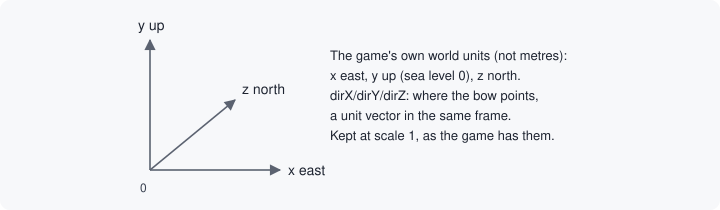

# The table

One row per sample or event, in `<match>.parquet`.

| Column | What |
|---|---|
| `match`, `map` | the battle's id; the map (`spaces/54_Faroe`) |
| `time` | seconds since the recording began (the countdown is in it) |
| `battleTime` | seconds since the battle began; negative during the countdown |
| `event` | what the row is (below) |
| `player`, `team`, `own` | the player's name; `ally` or `enemy` of the recording player; `1` on the recording player's rows |
| `vehicle`, `type` | the recording player's ship by name (`PASB018-Iowa-1944`), the others by the game's ship number (`4253956080`) unless `--ship-names` names them; `battleship`, `cruiser`, `destroyer`, `aircraft carrier`, `submarine` where the name says, else `ship` |
| `x`, `y`, `z` | the game's world units: x east, y up (sea level 0), z north |
| `dirX`, `dirY`, `dirZ` | where the bow points, a unit vector in the same frame (`dirY` 0: heading only); on a shell or torpedo the way it went |
| `other`, `reason` | the other ship of an event (killer, victim, attacker); the game's cause number for a sinking (not named), the hit type for an impact, the channel for chat |
| `value`, `health` | the event's number (damage, a shell's or torpedo's speed in world units a second); the ship's health after a hit |
| `text` | a chat line |
| `shot`, `params` | a salvo's id; the shell's or torpedo's type, as the game's parameter number |
| `entity` | the ship's id in the replay |
| `pitch`, `roll` | on a position, the ship's pitch and roll (radians) as the game sends them: a ship heels in a turn |

| `event` | On the row of | What |
|---|---|---|
| `position` | every ship | while the client saw it |
| `death`, `kill` | the victim, the killer | each sinking twice: where the ship sank, and where its killer was |
| `hurt`, `damage` | the victim, the attacker | a hit: `value` the damage, `health` what is left |
| `shot` | the shooter | one row per shell, at the gun, in the direction it flew |
| `torpedo` | the shooter | one row per torpedo, where it was launched, in the direction it ran |
| `impact` | the shooter | where a shell ended (hit, miss into the water, ...); `reason` the hit type number; on a ship (any type but 0 water, 8, 32, 64 land, within 6 units of a ship) `other`/`otherVehicle`/`otherType` the ship and `hitLocalX/Y/Z` the point in its frame (m at 15 m a unit: x forward, y up from the sea, z right) |
| `chat` | the sender | `text` the line, `reason` the channel (`battle_team`, `battle_common`) |

**Units.** A world unit is not a metre. A battleship at speed covers about 2.4
of them a second, and a map is about 1,200 across. Placed against the ships'
hull geometry, a unit is 15 m; the game's own range figures make it 30 m
(landaire/wows-toolkit, `crates/wows-core/src/units.rs`, MIT, which leaves the
two unreconciled). The table keeps world units at scale 1, as every 3DHeat
source keeps its game's own units, so a level exported in the same units lines
up. The footer's `heat3d` hints: Y up, Z flipped (so the map is not mirrored),
a ship 12 units long, `player` as the person, `team` as the group, `match` as
the session.

---

Part of [3DHeat](https://github.com/Holdi601/3DHeat) ([documentation](https://holdi601.github.io/3DHeat/)). Source: [3DHeat-Ext-WoWs](https://github.com/Holdi601/3DHeat-Ext-WoWs).
