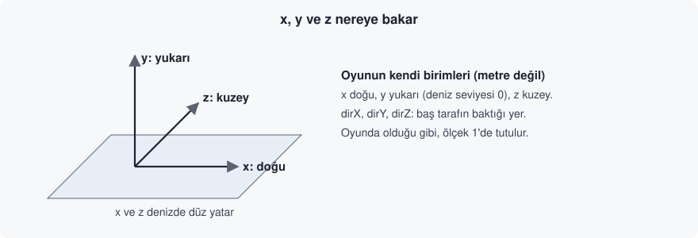

# Tablo {#the-table}

`<match>.parquet` dosyasında örnek ya da olay başına bir satır: 31 sütun
([Sütun listesi](../columns.md), koddan üretilmiştir).

| Sütun | Ne |
|---|---|
| `match`, `map` | savaşın kimliği; harita (resimlerde `spaces/99_testmap`) |
| `time` | kaydın başlamasından beri saniye (geri sayım da içindedir) |
| `battleTime` | savaşın başlamasından beri saniye; geri sayım sırasında negatif |
| `event` | satırın ne olduğu (aşağıda) |
| `player`, `team`, `own` | oyuncunun adı; kayıt oyuncusuna göre `ally` ya da `enemy`; kayıt oyuncusunun satırlarında `1` |
| `vehicle`, `type` | kayıt oyuncusunun gemisi adıyla (`PASB018-Iowa-1944`), diğerleri oyunun gemi numarasıyla (`4253956080`), `--ship-names` adlandırmadıkça; ad söylediğinde `battleship`, `cruiser`, `destroyer`, `aircraft carrier`, `submarine`, yoksa `ship` |
| `x`, `y`, `z` | oyunun dünya birimleri: x doğu, y yukarı (deniz seviyesi 0), z kuzey |
| `dirX`, `dirY`, `dirZ` | geminin baş tarafının baktığı yer, aynı çerçevede bir birim vektör (`dirY` 0: yalnızca yön); bir mermide ya da torpidoda gidiş yönü |
| `other`, `reason` | bir olayın diğer gemisi (öldüren, kurban, saldıran); bir batırma için oyunun adlandırılmamış neden numarası, bir çarpma için isabet türü, sohbet için kanal |
| `value`, `health` | olayın sayısı (hasar, bir mermi ya da torpidonun dünya birimi cinsinden saniyedeki hızı); bir isabetten sonra geminin canı |
| `text` | bir sohbet satırı |
| `shot`, `params` | bir salvonun kimliği; mermi ya da torpidonun türü, oyunun parametre numarası olarak |
| `entity` | geminin tekrardaki kimliği |
| `otherVehicle`, `otherType` | bir gemi üzerindeki `impact` için: o gemi ve sınıfı |
| `hitLocalX`, `hitLocalY`, `hitLocalZ` | bir gemi üzerindeki `impact` için: merminin o geminin kendi çerçevesinde bittiği yer, metre cinsinden (dünya birimi çarpı 15): x ileri, y deniz seviyesinden yukarı, z sağa |
| `pitch`, `roll` | bir konumda, geminin eğimi ve yalpası (radyan), oyunun gönderdiği gibi: bir gemi dönüşte yatar |

| `event` | Hangi satırda | Ne |
|---|---|---|
| `position` | her gemi | istemci onu gördüğü sürece |
| `death`, `kill` | kurban, öldüren | her batırma iki kez: geminin battığı yer ve öldürenin yeri |
| `hurt`, `damage` | kurban, saldıran | bir isabet: `value` hasar, `health` kalan |
| `shot` | atıcı | mermi başına bir satır, topta, uçtuğu yönde |
| `torpedo` | atıcı | torpido başına bir satır, fırlatıldığı yerde, koştuğu yönde |
| `impact` | atıcı | bir merminin bittiği yer (isabet, suya düşüp ıskalama, ...); `reason` isabet türü numarası; bir gemi üzerinde (0 su, 8, 32, 64 kara dışında herhangi bir tür, bir geminin 6 birim içinde) `other`/`otherVehicle`/`otherType` gemi ve `hitLocalX/Y/Z` onun çerçevesindeki nokta (yukarıda) |
| `chat` | gönderen | `text` satır, `reason` kanal (`battle_team`, `battle_common`) |

**Birimler.** Dünya birimi bir metre değildir. Hızda bir savaş gemisi saniyede yaklaşık 2,4 birim kat eder ve bir harita
yaklaşık 1.200 birim genişliğindedir. Geminin gövde geometrisine göre bir birim 15 m'dir; oyunun kendi menzil
değerleri ise 30 m yapar (landaire/wows-toolkit, `crates/wows-core/src/units.rs`, MIT, ikisini uzlaştırmaz). Tablo dünya
birimlerini ölçek 1'de tutar; her 3DHeat kaynağı kendi oyununun birimlerini tuttuğu gibi, bu yüzden aynı birimlerle
dışa aktarılan bir harita hizalanır. Altbilgideki `heat3d` ipuçları: Y yukarı, Z ters çevrilmiş (böylece harita aynalanmaz),
12 birim uzunluğunda bir gemi, `player` kişi olarak, `team` grup olarak, `match` oturum olarak.

---

[3DHeat](https://github.com/Holdi601/3DHeat) parçası ([belgeler](https://holdi601.github.io/3DHeat/)). Kaynak: [3DHeat-Ext-WoWs](https://github.com/Holdi601/3DHeat-Ext-WoWs).
