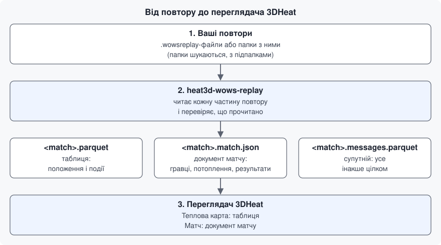

# Відтворення боїв World of Warships у 3DHeat {#dheat-world-of-warships-replays}

**Що це?** World of Warships може зберігати кожен ваш бій як файл повтору. Цей
інструмент перетворює ці файли на таблицю і документ матчу (підсумок бою), які
[переглядач 3DHeat](https://holdi601.github.io/3DHeat/) показує в 3D: куди плив
кожен корабель, куди стріляв і в кого потрапляв.

**Навіщо це потрібно?** Щоб переглянути бій знову зверху, усі кораблі разом; щоб
побачити теплові карти того, де ви і інші плаваєте, б'єтеся й тонете за сотні
боїв; щоб побачити, куди полетіли снаряди і торпеди; або щоб читати повтор своїми
скриптами, бо результат — це звичайні файли Parquet і JSON.

**Приклад:** на вхід один файл повтору, на виході таблиця і документ матчу:



## Швидкий старт {#quick-start}

Ви ще не працювали з командним рядком? Спочатку прочитайте
[Перш ніж почати](before-you-start.md).

```bash
git clone https://github.com/Holdi601/3DHeat-Ext-WoWs.git
cd 3DHeat-Ext-WoWs
pip install -e .
heat3d-wows-replay "<World of Warships>/replays" -o out
```

Ви побачите по одному рядку на повтор, який закінчується назвою файлу, що його
записано: `... -> out/<map>/<match>.parquet`. Відкрийте цей файл і поруч
`<match>.match.json` у переглядачі 3DHeat.

## Ця документація {#this-documentation}

| Сторінка | Про що вона |
|---|---|
| [Перш ніж почати](before-you-start.md) | Python, термінал і як виглядає успіх |
| [Встановлення](installing.md) | встановлення, перевірка, оновлення |
| [Перетворення повторів](converting.md) | крок за кроком, кожна опція, повідомлення, статус виходу |
| [Таблиця](table.md) | кожна колонка і подія `<match>.parquet` |
| [Документ матчу](match-document.md) | кожен ключ `<match>.match.json` |
| [Як читається повтор](how-it-reads.md) | формат і те, як перевірено читання |
| [Повнота](completeness.md) | супутній файл і самоперевірка |
| [Умови і ліцензія](terms.md) | що він читає, ліцензія, джерела |
| [Довідка з командами](../cli-reference.md), [Список колонок](../columns.md) | створено з коду |

## Частина 3DHeat {#part-of-3dheat}

Цей конвертер — один з інструментів [3DHeat](https://github.com/Holdi601/3DHeat),
переглядача 3D-телеметрії й повторів у реальному часі
([документація](https://holdi601.github.io/3DHeat/)). Переглядач відкриває таблицю
на своїй вкладці «Теплова карта», а документ матчу — на вкладці «Матч». Він може
упакувати файли матчу в один файл:
[Один файл на матч](https://holdi601.github.io/3DHeat/container.html). Що має
зберігати кожен конвертер:
[Конвертери зберігають усе](https://holdi601.github.io/3DHeat/converters.html).

Кожен модуль читання гри - окремий невеликий проєкт із власним файлом
ліцензії, випусками і трекером задач, тож його можна встановлювати,
оновлювати, підтримувати - або відкликати на запит правовласника - окремо, не
зачіпаючи переглядач та інші інструменти. Watcher запускає цей конвертер, коли
він встановлений, і працює без нього. Що читає конвертер: [Умови і
ліцензія](terms.md).

| Інструмент | Що робить | Джерело | Документація |
|---|---|---|---|
| Переглядач 3DHeat | показує дані у 3D: теплові карти, повтори, аналіз заїздів | [3DHeat](https://github.com/Holdi601/3DHeat) | [сайт](https://holdi601.github.io/3DHeat/) |
| GameFiles | маршрути і рівні з файлів, які постачають ігри | [3DHeat-GameFiles](https://github.com/Holdi601/3DHeat-GameFiles) | [сайт](https://holdi601.github.io/3DHeat-GameFiles/) |
| GameCapture | телеметрія кругів і рівні, відтворені з відеозапису гри | [3DHeat-GameCapture](https://github.com/Holdi601/3DHeat-GameCapture) | [сайт](https://holdi601.github.io/3DHeat-GameCapture/) |
| Unreal Exporter | плагін редактора Unreal Editor, який експортує рівень | [3DHeat-UnrealExporter](https://github.com/Holdi601/3DHeat-UnrealExporter) | [сайт](https://holdi601.github.io/3DHeat-UnrealExporter/) |
| CS2 | демо і карти Counter-Strike 2 | [3DHeat-CS2](https://github.com/Holdi601/3DHeat-CS2) | [сайт](https://holdi601.github.io/3DHeat-CS2/) |
| Watcher | записує те, що ігри публікують, поки ви граєте | [3DHeat-Watcher](https://github.com/Holdi601/3DHeat-Watcher) | [сайт](https://holdi601.github.io/3DHeat-Watcher/) |
| Повтори War Thunder | повтори `.wrpl` і рівні War Thunder | [3DHeat-Ext-WarThunder](https://github.com/Holdi601/3DHeat-Ext-WarThunder) | [сайт](https://holdi601.github.io/3DHeat-Ext-WarThunder/) |
| Повтори World of Tanks | повтори `.wotreplay` | [3DHeat-Ext-WoT](https://github.com/Holdi601/3DHeat-Ext-WoT) | [сайт](https://holdi601.github.io/3DHeat-Ext-WoT/) |
| Повтори World of Warships | повтори `.wowsreplay` | [3DHeat-Ext-WoWs](https://github.com/Holdi601/3DHeat-Ext-WoWs) | [сайт](https://holdi601.github.io/3DHeat-Ext-WoWs/) |
| Демо Squad | демо серверів Squad | [3DHeat-Ext-Squad](https://github.com/Holdi601/3DHeat-Ext-Squad) | [сайт](https://holdi601.github.io/3DHeat-Ext-Squad/) |
| Карти DCS | карти DCS World як 3D-рівні | [3DHeat-Ext-DCS](https://github.com/Holdi601/3DHeat-Ext-DCS) | [сайт](https://holdi601.github.io/3DHeat-Ext-DCS/) |
| Карти IL-2 | карти IL-2 Great Battles як 3D-рівні | [3DHeat-Ext-IL2](https://github.com/Holdi601/3DHeat-Ext-IL2) | [сайт](https://holdi601.github.io/3DHeat-Ext-IL2/) |

---

Джерело: [3DHeat-Ext-WoWs](https://github.com/Holdi601/3DHeat-Ext-WoWs).
