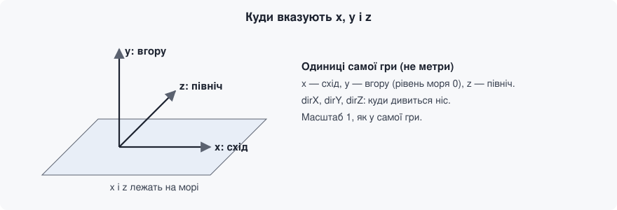

# Таблиця {#the-table}

Один рядок на відлік або подію, у `<match>.parquet`: 31 колонка
([Список колонок](../columns.md), створений з коду).

| Колонка | Що це |
|---|---|
| `match`, `map` | ідентифікатор бою; карта (`spaces/99_testmap` на малюнках) |
| `time` | секунди від початку запису (відлік до старту теж у ньому) |
| `battleTime` | секунди від початку бою; від'ємні під час відліку |
| `event` | що це за рядок (нижче) |
| `player`, `team`, `own` | назва гравця; `ally` або `enemy` для гравця, що записав повтор; `1` у рядках гравця, що записав повтор |
| `vehicle`, `type` | корабель гравця, що записав повтор, за назвою (`PASB018-Iowa-1944`), інші — за номером корабля в грі (`4253956080`), якщо `--ship-names` їх не називає; `battleship`, `cruiser`, `destroyer`, `aircraft carrier`, `submarine`, де це видно з назви, інакше `ship` |
| `x`, `y`, `z` | світові одиниці гри: x — схід, y — вгору (рівень моря 0), z — північ |
| `dirX`, `dirY`, `dirZ` | куди дивиться ніс, одиничний вектор у тій самій системі координат (`dirY` 0: лише курс); для снаряда або торпеди — куди вони полетіли |
| `other`, `reason` | інший корабель події (вбивця, жертва, атакуючий); номер причини гри для потоплення, тип влучання для удару, канал для чату |
| `value`, `health` | число події (шкода, швидкість снаряда або торпеди у світових одиницях за секунду); здоров'я корабля після влучання |
| `text` | рядок чату |
| `shot`, `params` | ідентифікатор залпу; тип снаряда або торпеди, як номер параметра гри |
| `entity` | ідентифікатор корабля в повторі |
| `otherVehicle`, `otherType` | у `impact` по кораблю: цей корабель і його клас |
| `hitLocalX`, `hitLocalY`, `hitLocalZ` | у `impact` по кораблю: де закінчився снаряд у системі координат цього корабля, у метрах (світові одиниці помножено на 15): x — вперед, y — вгору від моря, z — праворуч |
| `pitch`, `roll` | для положення — тангаж і крен корабля (радіани), як їх надсилає гра: корабель нахиляється на повороті |

| `event` | У рядку чого | Що це |
|---|---|---|
| `position` | кожного корабля | поки клієнт його бачив |
| `death`, `kill` | жертви, вбивці | кожне потоплення двічі: де корабель затонув і де був його вбивця |
| `hurt`, `damage` | жертви, атакуючого | влучання: `value` — шкода, `health` — що лишилося |
| `shot` | стрільця | один рядок на снаряд, на гарматі, у напрямку, куди він полетів |
| `torpedo` | стрільця | один рядок на торпеду, де її випустили, у напрямку, куди вона пішла |
| `impact` | стрільця | де закінчився снаряд (влучання, промах у воду, ...); `reason` — номер типу влучання; по кораблю (будь-якого типу, крім 0 — вода, 8, 32, 64 — суша, на відстані 6 одиниць від корабля) `other`/`otherVehicle`/`otherType` — корабель, а `hitLocalX/Y/Z` — точка в його системі координат (див. вище) |
| `chat` | відправника | `text` — рядок, `reason` — канал (`battle_team`, `battle_common`) |

**Одиниці.** Світова одиниця — це не метр. Бойовий корабель на ходу проходить близько
2,4 такої одиниці за секунду, а карта має близько 1 200 у поперечнику. Порівняно з
геометрією корпусів кораблів одна одиниця — це 15 м; власні дані дальностей гри дають
30 м (landaire/wows-toolkit, `crates/wows-core/src/units.rs`, MIT, обидва не узгоджено).
Таблиця зберігає світові одиниці у масштабі 1, як кожне джерело 3DHeat зберігає
власні одиниці своєї гри, тож рівень, експортований в тих самих одиницях, лягає точно.
Нижній колонтитул `heat3d`-підказки: Y вгору, Z перевернуто (тож карта не відзеркалена),
корабель завдовжки 12 одиниць, `player` як людина, `team` як група, `match` як сесія.

---

Частина [3DHeat](https://github.com/Holdi601/3DHeat) ([документація](https://holdi601.github.io/3DHeat/)). Джерело: [3DHeat-Ext-WoWs](https://github.com/Holdi601/3DHeat-Ext-WoWs).
