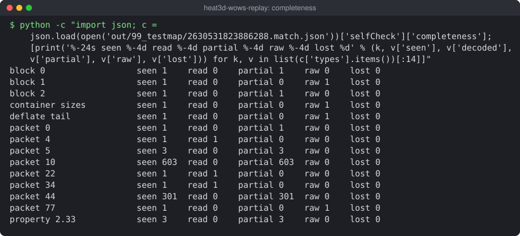

# 完整性 {#completeness}

回放中沒有任何東西會被丟棄。轉換器讀取的內容會放入表格與對戰文件；其他每個項目都會完整保存在附屬檔案 `<match>.messages.parquet` 中；而對戰文件中的 `selfCheck.completeness` 會計算每一類項目的去向。這是所有 3DHeat 轉換器共同遵守的規則：[轉換器保留一切](https://holdi601.github.io/3DHeat/converters.html)。

## 計數 {#the-count}

對於每一類項目，`selfCheck.completeness.types` 提供以下數字：

| 計數 | 意義 |
|---|---|
| `seen` | 回放中有多少個 |
| `decoded` | 完整讀取 |
| `partial` | 部分讀取，並完整保存在附屬檔案中 |
| `raw` | 只完整保存在附屬檔案中，未讀取 |
| `lost` | 遺失：永遠為 `0` |

類別來自回放本身：`block <n>`（JSON 區塊）、容器本身的位元組、`packet <type>`，以及對實體的呼叫：`method <entity type>.<number>` 與 `property <entity type>.<number>`。`selfCheck.entities.roles` 說明哪一個實體類型是錄製玩家的化身，哪些是船艦。無人知道的類別會以其計數出現。

## 附屬檔案 {#the-sidecar}

| 欄位 | 內容 |
|---|---|
| `time` | 回放的時鐘，與表格相同 |
| `type`、`name` | 項目的類別；轉換器如何稱呼它，以及它在哪裡被讀取 |
| `entity` | 它所屬的船艦或化身，與表格的 `entity` 相同 |
| `decoded` | 讀取到的內容，以 JSON 表示 |
| `payload`、`text` | 其位元組，完整保存；JSON 區塊，完整保存 |
| `entityType`、`packet`、`method` | 編號 |

列依封包、方法、實體與時間排序。哪個實體是哪位玩家：見對戰文件中的 `entities` 與 `players`。

## 讀取了什麼，以及如何核對 {#what-is-read-and-how-it-was-checked}

- **結算**（15.x，`results`）：其戰鬥 id 與串流相同，且其中每位玩家都在標頭的名單中。
- **id 區塊**（15.x，`blockIds`）：帳號與戰鬥，以文字讀取，因此不會遺失任何數字。
- **每個位置的俯仰與橫滾：**橫滾隨轉向速率而變，如同船艦在轉彎時傾斜；俯仰幾乎總是 0。
- **實體**（`entities`）：每個實體何時進入客戶端的視野、何時離開。船艦在離開與再次出現之間，沒有任何位置。
- **串流中的版本**（`streamVersion`）：與標頭的版本相同。

其餘讀取到的內容（沉沒、傷害、血量、砲彈、魚雷、砲彈的落點、聊天、以 pickle 保存的呼叫、玩家紀錄、位置）都是 `partial`：會出現在表格或對戰文件中，並完整保存在附屬檔案中。

**保留但未讀取**（`raw`）的主要類別：不在表格中的位置更新（船艦沉沒後的、沒有玩家的實體）、沒有讀取器的頻繁屬性與方法、實體建立的屬性，以及其他沒有讀取器的封包。

## 無法取得的內容 {#not-available}

- 伺服器從未送給錄製客戶端的資料：其他玩家的瞄準、攝影機與操作，以及未被發現時的敵人。回放只是一個客戶端被告知的內容。
- 實體類型、方法、屬性以及統計數據的鍵名：它們在遊戲的定義檔案中，而不在回放裡。編號會被保留。
- 船艦編號對應的船名（使用 `--ship-names`），以及任何需要遊戲自身檔案的其他內容。
- 15.x 之前的客戶端的結算：它們的回放中沒有。

---

屬於 [3DHeat](https://github.com/Holdi601/3DHeat)（[說明文件](https://holdi601.github.io/3DHeat/)）的一部分。來源：[3DHeat-Ext-WoWs](https://github.com/Holdi601/3DHeat-Ext-WoWs)。
