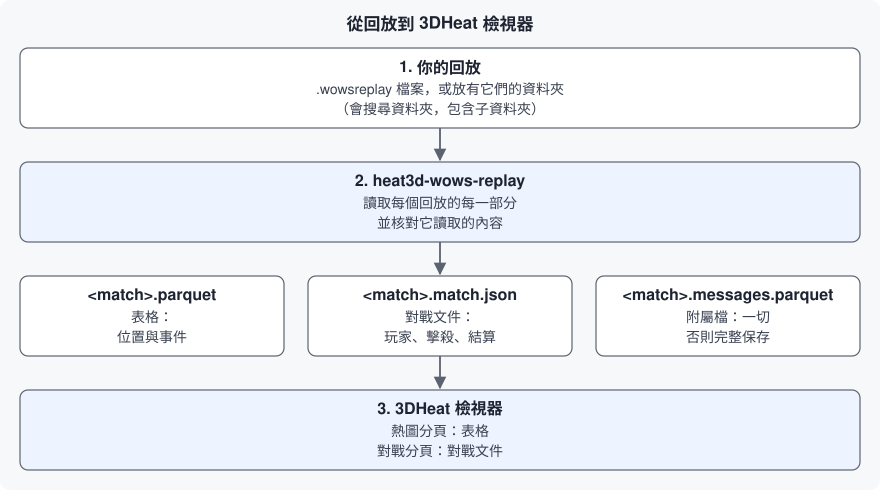

# 3DHeat 戰艦世界回放 {#dheat-world-of-warships-replays}

**這是什麼？**World of Warships 可以把你玩過的每場戰鬥存成回放檔。這個工具會把這些檔案轉成一張表格與一份對戰文件（即戰鬥摘要），讓 [3DHeat 檢視器](https://holdi601.github.io/3DHeat/)以 3D 顯示：每艘船的航行路線、開火與被命中的情況。

**為什麼要用它？**從上方重新觀看一場戰鬥，所有船同時呈現；查看你和其他人在數百場戰鬥中航行、交戰與擊沉的熱圖；查看砲彈與魚雷的去向；或用你自己的腳本讀取回放，因為輸出是一般的 Parquet 與 JSON。

**範例：**輸入一個回放檔，輸出一張表格與一份對戰文件：



## 快速開始 {#quick-start}

第一次使用命令列嗎？請先閱讀[開始之前](before-you-start.md)。

```bash
git clone https://github.com/Holdi601/3DHeat-Ext-WoWs.git
cd 3DHeat-Ext-WoWs
pip install -e .
heat3d-wows-replay "<World of Warships>/replays" -o out
```

你會看到每個回放一行，最後是它寫出的檔案：`... -> out/<map>/<match>.parquet`。請在 3DHeat 檢視器中開啟該檔案，以及它旁邊的 `<match>.match.json`。

## 本說明文件 {#this-documentation}

| 頁面 | 涵蓋內容 |
|---|---|
| [開始之前](before-you-start.md) | Python、終端機，以及成功的樣子 |
| [安裝](installing.md) | 安裝、檢查、更新 |
| [轉換回放](converting.md) | 逐步說明、每個選項、訊息、結束狀態 |
| [表格](table.md) | `<match>.parquet` 的每個欄位與事件 |
| [對戰文件](match-document.md) | `<match>.match.json` 的每個鍵 |
| [讀取回放的方式](how-it-reads.md) | 格式，以及讀取是如何核對的 |
| [完整性](completeness.md) | 附屬檔案與自我檢查 |
| [名詞與授權](terms.md) | Wargaming 的條款、授權、來源 |
| [指令參考](../cli-reference.md)、[欄位清單](../columns.md) | 由程式碼產生 |

## 3DHeat 的一部分 {#part-of-3dheat}

這個轉換器是 [3DHeat](https://github.com/Holdi601/3DHeat) 的工具之一。3DHeat 是即時 3D 遙測與回放檢視器（[說明文件](https://holdi601.github.io/3DHeat/)）。檢視器會在熱圖分頁中開啟表格，在對戰分頁中開啟對戰文件。它也能把一場對戰的檔案打包成一個檔案：[每場對戰一個檔案](https://holdi601.github.io/3DHeat/container.html)。每個轉換器都必須保留的內容：[轉換器保留一切](https://holdi601.github.io/3DHeat/converters.html)。

此轉換器刻意與 3DHeat Watcher 分開：回放是加密的，而 Wargaming 的條款涵蓋範圍很廣（[名詞與授權](terms.md)）。如果它必須被移除，其他部分不會連帶受到影響。安裝 Watcher 時，Watcher 會執行它；沒有它，Watcher 也能運作。

| 工具 | 功能 | 原始碼 | 說明文件 |
|---|---|---|---|
| 3DHeat 檢視器 | 以 3D 顯示資料：熱圖、回放、賽車分析 | [3DHeat](https://github.com/Holdi601/3DHeat) | [網站](https://holdi601.github.io/3DHeat/) |
| GameFiles | 從遊戲隨附的檔案中取出賽道與地圖 | [3DHeat-GameFiles](https://github.com/Holdi601/3DHeat-GameFiles) | [網站](https://holdi601.github.io/3DHeat-GameFiles/) |
| GameCapture | 單圈遙測，以及從遊戲影片重建的地圖 | [3DHeat-GameCapture](https://github.com/Holdi601/3DHeat-GameCapture) | [網站](https://holdi601.github.io/3DHeat-GameCapture/) |
| Unreal Exporter | 匯出地圖的 Unreal Editor 外掛 | [3DHeat-UnrealExporter](https://github.com/Holdi601/3DHeat-UnrealExporter) | [網站](https://holdi601.github.io/3DHeat-UnrealExporter/) |
| CS2 | Counter-Strike 2 的示範與地圖 | [3DHeat-CS2](https://github.com/Holdi601/3DHeat-CS2) | [網站](https://holdi601.github.io/3DHeat-CS2/) |
| Watcher | 在你遊玩時記錄遊戲所公開的內容 | [3DHeat-Watcher](https://github.com/Holdi601/3DHeat-Watcher) | [網站](https://holdi601.github.io/3DHeat-Watcher/) |
| War Thunder 回放 | `.wrpl` 回放與 War Thunder 地圖 | [3DHeat-Ext-WarThunder](https://github.com/Holdi601/3DHeat-Ext-WarThunder) | [網站](https://holdi601.github.io/3DHeat-Ext-WarThunder/) |
| World of Tanks 回放 | `.wotreplay` 回放 | [3DHeat-Ext-WoT](https://github.com/Holdi601/3DHeat-Ext-WoT) | [網站](https://holdi601.github.io/3DHeat-Ext-WoT/) |
| World of Warships 回放 | `.wowsreplay` 回放 | [3DHeat-Ext-WoWs](https://github.com/Holdi601/3DHeat-Ext-WoWs) | [網站](https://holdi601.github.io/3DHeat-Ext-WoWs/) |
| Squad 示範 | Squad 伺服器示範 | [3DHeat-Ext-Squad](https://github.com/Holdi601/3DHeat-Ext-Squad) | [網站](https://holdi601.github.io/3DHeat-Ext-Squad/) |
| DCS 地圖 | DCS World 地圖，轉為 3D 關卡 | [3DHeat-Ext-DCS](https://github.com/Holdi601/3DHeat-Ext-DCS) | [網站](https://holdi601.github.io/3DHeat-Ext-DCS/) |
| IL-2 地圖 | IL-2 Great Battles 地圖，轉為 3D 關卡 | [3DHeat-Ext-IL2](https://github.com/Holdi601/3DHeat-Ext-IL2) | [網站](https://holdi601.github.io/3DHeat-Ext-IL2/) |

---

來源：[3DHeat-Ext-WoWs](https://github.com/Holdi601/3DHeat-Ext-WoWs)。
