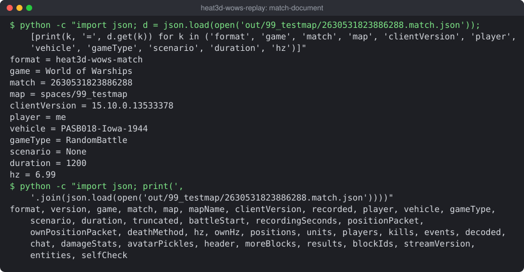

# 對戰文件 {#the-match-document}

`<match>.match.json` 保存了回放所記錄、但不屬於表格中任何一列的所有內容。檢視器的對戰分頁會讀取它。（程式碼稱它為摘要。）

## 戰鬥 {#the-battle}

| 鍵 | 內容 |
|---|---|
| `format`、`version` | `heat3d-wows-match`、`2` |
| `game`、`match`、`map`、`mapName` | `World of Warships`；戰鬥的 id；遊戲所命名的地圖（`spaces/<map>`）及其顯示名稱 |
| `clientVersion`、`streamVersion` | 標頭中的遊戲版本，以及封包串流所示的版本 |
| `recorded` | 回放錄製的時間，依遊戲的寫法 |
| `player`、`vehicle` | 錄製玩家及其船 |
| `gameType`、`scenario` | 戰鬥的類型（`RandomBattle` 等）與劇本，取自標頭 |
| `duration` | 戰鬥的時間限制（秒），取自標頭 |
| `truncated` | 錄製提前停止 |
| `battleStart`、`recordingSeconds` | 戰鬥的開始（任何船第一次移動的時刻）與錄製的長度，以秒為單位 |
| `positionPacket`、`ownPositionPacket` | 位置所在的封包編號：其他船的，以及錄製玩家的 |
| `deathMethod` | 找到沉沒紀錄所在的方法編號 |
| `hz`、`ownHz`、`positions` | 其他船與自己的船每秒取樣數；位置列 |
| `units` | 世界單位（依船體為 15 公尺，依遊戲的射程為 30 公尺）；x 朝東、y 向上、z 朝北 |
| `events` | 表格中每種事件的列數 |
| `decoded` | 每一類訊息所找到的方法與封包編號 |

## 玩家與事件 {#players-and-events}

| 鍵 | 內容 |
|---|---|
| `players` | 每艘船一筆：名稱、`ally`（友方）或 `enemy`（敵方）、船的編號與名稱、實體、取樣數、擊殺、是否存活；`seen`（客戶端所見的造成與承受傷害、砲彈、魚雷與最後血量）；`header`（名單中的項目）與 `record`（串流中該玩家的紀錄，依鍵編號） |
| `kills` | 每次沉沒：時間、受害者、擊殺者、原因編號、地點 |
| `chat` | 每一行聊天，附頻道與發送者 |
| `damageStats` | 遊戲所保存的錄製玩家自己的統計：依武器與類別，有次數與數量（類別 0 為造成的傷害） |
| `avatarPickles` | 送給錄製玩家的每個 pickle 呼叫，已解碼，依方法編號排列 |

## 標頭、結算與檢查 {#header-results-and-checks}

| 鍵 | 內容 |
|---|---|
| `header` | 第一個 JSON 區塊，除名單之外的全部：遊戲模式、天氣、地圖邊界、隊伍人數等 |
| `moreBlocks` | 第一個之後的 JSON 區塊，原樣保存 |
| `blockIds` | 15.x：錄製玩家的帳號與戰鬥 id，以文字讀取 |
| `results` | 15.x：結算，這些客戶端把它保存在串流中 |
| `entities` | 串流建立的每個實體：其類型編號與角色、何時進入客戶端的視野、何時離開 |
| `selfCheck` | 完整性計數（[完整性](completeness.md)），以及實體、結算、id 與版本的檢查 |

---

屬於 [3DHeat](https://github.com/Holdi601/3DHeat)（[說明文件](https://holdi601.github.io/3DHeat/)）的一部分。來源：[3DHeat-Ext-WoWs](https://github.com/Holdi601/3DHeat-Ext-WoWs)。
