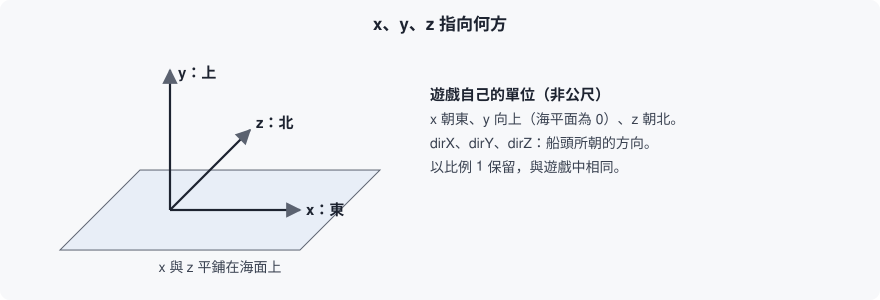

# 表格 {#the-table}

`<match>.parquet` 中每個取樣或事件一列，共 31 個欄位（[欄位清單](../columns.md)，由程式碼產生）。

| 欄位 | 內容 |
|---|---|
| `match`、`map` | 戰鬥的 id；地圖（圖中為 `spaces/99_testmap`） |
| `time` | 自錄製開始起的秒數（倒數也包含在內） |
| `battleTime` | 自戰鬥開始起的秒數；倒數期間為負值 |
| `event` | 此列是什麼（見下文） |
| `player`、`team`、`own` | 玩家的名稱；相對於錄製玩家的 `ally`（友方）或 `enemy`（敵方）；錄製玩家的列為 `1` |
| `vehicle`、`type` | 錄製玩家的船以名稱表示（`PASB018-Iowa-1944`），其他船則以遊戲的船編號表示（`4253956080`），除非 `--ship-names` 為其命名；若名稱能判斷，則為 `battleship`、`cruiser`、`destroyer`、`aircraft carrier`、`submarine`，否則為 `ship` |
| `x`、`y`、`z` | 遊戲的世界單位：x 朝東、y 向上（海平面為 0）、z 朝北 |
| `dirX`、`dirY`、`dirZ` | 船頭所朝的方向，同一座標系中的單位向量（`dirY` 為 0：只有航向）；在砲彈或魚雷上，則為其行進的方向 |
| `other`、`reason` | 事件中的另一艘船（擊殺者、受害者、攻擊者）；沉沒時為遊戲的原因編號（未命名），落點時為命中類型，聊天時為頻道 |
| `value`、`health` | 事件的數值（傷害，或砲彈與魚雷每秒的世界單位速度）；命中後船的血量 |
| `text` | 一行聊天 |
| `shot`、`params` | 一輪攻擊的 id；砲彈或魚雷的類型，即遊戲參數的編號 |
| `entity` | 船在回放中的 id |
| `otherVehicle`、`otherType` | 在船上的 `impact` 事件中：該船及其類別 |
| `hitLocalX`、`hitLocalY`、`hitLocalZ` | 在船上的 `impact` 事件中：砲彈在該船自己座標系中的落點，以公尺為單位（世界單位乘以 15）：x 向前、y 為海面以上、z 向右 |
| `pitch`、`roll` | 在位置上，遊戲送出的船的俯仰與橫滾（弧度）：船在轉彎時會傾斜 |

| `event` | 記在哪一列上 | 內容 |
|---|---|---|
| `position` | 每艘船 | 客戶端看見它的時候 |
| `death`、`kill` | 受害者、擊殺者 | 每次沉沒記錄兩次：船沉沒之處，以及擊殺者所在之處 |
| `hurt`、`damage` | 受害者、攻擊者 | 一次命中：`value` 為傷害，`health` 為剩餘血量 |
| `shot` | 射手 | 每發砲彈一列，位於火砲處，朝其飛行的方向 |
| `torpedo` | 射手 | 每枚魚雷一列，位於發射之處，朝其航行的方向 |
| `impact` | 射手 | 砲彈的落點（命中、落入水中未命中……）；`reason` 為命中類型編號；若落在船上（除 0 水面、8、32、64 陸地之外的任何類型，距離船 6 單位內），則 `other`/`otherVehicle`/`otherType` 為該船，`hitLocalX/Y/Z` 為其座標系中的點（見上文） |
| `chat` | 發送者 | `text` 為該行內容，`reason` 為頻道（`battle_team`、`battle_common`） |

**單位。**世界單位不是公尺。一艘高速前進的戰艦每秒大約移動 2.4 個單位，而一張地圖的寬度約為 1,200 個單位。依船體的幾何形狀來比對，一個單位是 15 公尺；遊戲自己的射程數值則使它成為 30 公尺（landaire/wows-toolkit，`crates/wows-core/src/units.rs`，MIT，兩者未調和）。表格以比例 1 保留世界單位，與所有 3DHeat 來源保留其遊戲自身單位的做法相同，因此以相同單位匯出的地圖能與之對齊。結尾的 `heat3d` 提示：Y 向上、Z 翻轉（因此地圖不會被鏡像）、一艘船長 12 個單位、`player` 為人、`team` 為群組、`match` 為工作階段。

---

屬於 [3DHeat](https://github.com/Holdi601/3DHeat)（[說明文件](https://holdi601.github.io/3DHeat/)）的一部分。來源：[3DHeat-Ext-WoWs](https://github.com/Holdi601/3DHeat-Ext-WoWs)。
