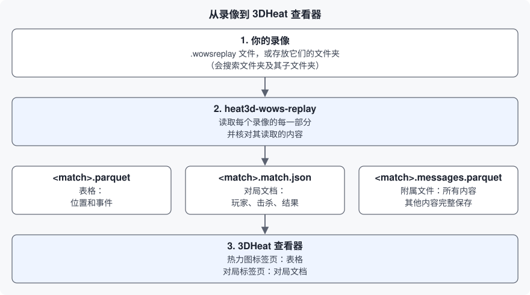

# 3DHeat 战舰世界录像 {#dheat-world-of-warships-replays}

**这是什么？** 战舰世界可以把你参加的每一场对局保存为录像文件。本工具会把这些文件转换为一张表格和一份对局文档（即对局摘要），[3DHeat 查看器](https://holdi601.github.io/3DHeat/) 会以 3D 方式展示它们：每艘舰船在何处航行、开火和被击中。

**我为什么要用它？** 为了从上方再次观看一场对局，所有舰船同时可见；为了查看你和其他人在数百场对局中航行、交战和沉没的位置热力图；为了查看炮弹和鱼雷的去向；或者为了用你自己的脚本读取录像，因为输出的是普通的 Parquet 和 JSON 文件。

**示例：** 输入一个录像文件，输出一张表格和一份对局文档：



## 快速开始 {#quick-start}

第一次使用命令行？请先阅读 [开始之前](before-you-start.md)。

```bash
git clone https://github.com/Holdi601/3DHeat-Ext-WoWs.git
cd 3DHeat-Ext-WoWs
pip install -e .
heat3d-wows-replay "<World of Warships>/replays" -o out
```

每个录像会输出一行，结尾是它写入的文件：`... -> out/<地图>/<对局>.parquet`。在 3DHeat 查看器中打开该文件，以及它旁边的 `<对局>.match.json`。

## 本文档 {#this-documentation}

| 页面 | 内容 |
|---|---|
| [开始之前](before-you-start.md) | Python、终端，以及成功是什么样子 |
| [安装](installing.md) | 安装、检查、更新 |
| [转换录像](converting.md) | 逐步说明，每个选项，消息，退出状态 |
| [表格](table.md) | `<对局>.parquet` 的每一列和每个事件 |
| [对局文档](match-document.md) | `<对局>.match.json` 中的每个键 |
| [工具如何读取录像](how-it-reads.md) | 格式，以及读取的核对方式 |
| [完整性](completeness.md) | 附属文件和自我检查 |
| [条款与许可](terms.md) | 它读取什么、许可证、来源 |
| [命令参考](../cli-reference.md)、[列清单](../columns.md) | 由代码生成 |

## 3DHeat 的一部分 {#part-of-3dheat}

本转换器是 [3DHeat](https://github.com/Holdi601/3DHeat) 的工具之一。3DHeat 是一个实时 3D 遥测与录像查看器（[文档](https://holdi601.github.io/3DHeat/)）。查看器会在其 **热力图** 标签页中打开表格，在其 **对局** 标签页中打开对局文档。它还可以把一场对局的文件打包成一个文件：[一个对局一个文件](https://holdi601.github.io/3DHeat/container.html)。每个转换器必须保留的内容：[转换器保留所有内容](https://holdi601.github.io/3DHeat/converters.html)。

每个游戏读取工具都是独立的小项目，有自己的许可证文件、发布版本和问题跟踪器，因此可以单独安装、更新、维护，或应权利人的要求撤下，而不影响查看器或其他工具。安装了本转换器时，Watcher 会运行它；没有它，Watcher 也能正常工作。本转换器读取什么：[条款与许可](terms.md)。

| 工具 | 作用 | 源代码 | 文档 |
|---|---|---|---|
| 3DHeat 查看器 | 在 3D 中显示数据：热力图、录像、赛车分析 | [3DHeat](https://github.com/Holdi601/3DHeat) | [网站](https://holdi601.github.io/3DHeat/) |
| GameFiles | 从游戏自带的文件中提取赛道和关卡 | [3DHeat-GameFiles](https://github.com/Holdi601/3DHeat-GameFiles) | [网站](https://holdi601.github.io/3DHeat-GameFiles/) |
| GameCapture | 赛车遥测，以及从游戏录像重建的关卡 | [3DHeat-GameCapture](https://github.com/Holdi601/3DHeat-GameCapture) | [网站](https://holdi601.github.io/3DHeat-GameCapture/) |
| Unreal Exporter | 一个导出关卡的 Unreal Editor 插件 | [3DHeat-UnrealExporter](https://github.com/Holdi601/3DHeat-UnrealExporter) | [网站](https://holdi601.github.io/3DHeat-UnrealExporter/) |
| CS2 | 反恐精英 2 的对局录像和地图 | [3DHeat-CS2](https://github.com/Holdi601/3DHeat-CS2) | [网站](https://holdi601.github.io/3DHeat-CS2/) |
| Watcher | 在你游玩时记录游戏发布的数据 | [3DHeat-Watcher](https://github.com/Holdi601/3DHeat-Watcher) | [网站](https://holdi601.github.io/3DHeat-Watcher/) |
| 战争雷霆录像 | `.wrpl` 录像和战争雷霆关卡 | [3DHeat-Ext-WarThunder](https://github.com/Holdi601/3DHeat-Ext-WarThunder) | [网站](https://holdi601.github.io/3DHeat-Ext-WarThunder/) |
| 坦克世界录像 | `.wotreplay` 录像 | [3DHeat-Ext-WoT](https://github.com/Holdi601/3DHeat-Ext-WoT) | [网站](https://holdi601.github.io/3DHeat-Ext-WoT/) |
| 战舰世界录像 | `.wowsreplay` 录像 | [3DHeat-Ext-WoWs](https://github.com/Holdi601/3DHeat-Ext-WoWs) | [网站](https://holdi601.github.io/3DHeat-Ext-WoWs/) |
| Squad 录像 | Squad 服务器录像 | [3DHeat-Ext-Squad](https://github.com/Holdi601/3DHeat-Ext-Squad) | [网站](https://holdi601.github.io/3DHeat-Ext-Squad/) |
| DCS 地图 | DCS World 地图，转换为 3D 关卡 | [3DHeat-Ext-DCS](https://github.com/Holdi601/3DHeat-Ext-DCS) | [网站](https://holdi601.github.io/3DHeat-Ext-DCS/) |
| IL-2 地图 | IL-2 Great Battles 地图，转换为 3D 关卡 | [3DHeat-Ext-IL2](https://github.com/Holdi601/3DHeat-Ext-IL2) | [网站](https://holdi601.github.io/3DHeat-Ext-IL2/) |

---

来源：[3DHeat-Ext-WoWs](https://github.com/Holdi601/3DHeat-Ext-WoWs)。
