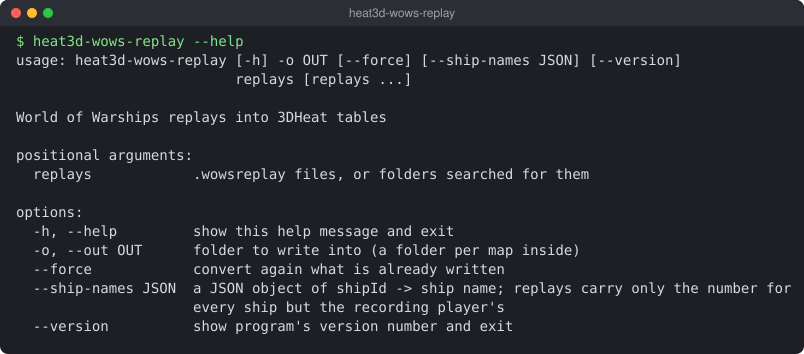

# 安装 {#installing}

刚接触命令行？先读 [开始之前](before-you-start.md)。需要 Python 3.10 或更高版本；numpy 和 pyarrow 会随之一起安装。

## 一步一步来 {#step-by-step}

1. 获取代码：`git clone https://github.com/Holdi601/3DHeat-Ext-WoWs.git`，或从 [Releases](https://github.com/Holdi601/3DHeat-Ext-WoWs/releases) 下载压缩包并解压。
2. 在该文件夹里打开终端，输入 `pip install -e .`。这会把 `heat3d-wows-replay` 命令加入你的 PATH。
3. 检查安装：`heat3d-wows-replay --version`。你应该看到 `heat3d-wows-replay 0.1.0`。`heat3d-wows-replay --help` 会列出所有选项：

不安装的话，在工具所在的文件夹里运行 `python -m heat3d_ext_wows ...`，效果相同。

安装了 3DHeat Watcher 时，它会对新录像运行这个命令；没有它，Watcher 也能正常工作。

## 更新 {#updates}

每次启动时，程序都会先检查项目在 GitHub 上的发布版（最多每几个小时请求一次；无论能否联网，都不会因此中断转换）。出现新版本时，命令会先询问，再安装它：用 `git clone` 得到的副本会用 `git pull --ff-only` 更新（如果你有本地改动，则会拒绝更新），下载的副本则从该发布版的压缩包更新。设置 `HEAT3D_NO_UPDATE=1` 可以同时关闭检查和更新。

---

本页是 [3DHeat](https://github.com/Holdi601/3DHeat) 的一部分（[文档](https://holdi601.github.io/3DHeat/)）。来源：[3DHeat-Ext-WoWs](https://github.com/Holdi601/3DHeat-Ext-WoWs)。
