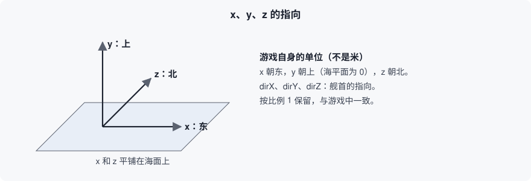

# 表格 {#the-table}

`<对局>.parquet` 中每个采样或事件占一行：共 31 列（[列清单](../columns.md)，由代码生成）。

| 列 | 内容 |
|---|---|
| `match`、`map` | 战斗的 ID；地图（图片中为 `spaces/99_testmap`） |
| `time` | 自录制开始以来的秒数（倒计时也包含在内） |
| `battleTime` | 自战斗开始以来的秒数；倒计时期间为负数 |
| `event` | 该行是什么（见下文） |
| `player`、`team`、`own` | 玩家名称；相对于录像播放者为 `ally`（友军）或 `enemy`（敌军）；在录像播放者的行上为 `1` |
| `vehicle`、`type` | 录像播放者的舰船使用名称（`PASB018-Iowa-1944`），其他舰船使用游戏的舰船编号（`4253956080`），除非 `--ship-names` 为其命名；若名称中有相关信息，则为 `battleship`（战列舰）、`cruiser`（巡洋舰）、`destroyer`（驱逐舰）、`aircraft carrier`（航空母舰）、`submarine`（潜艇），否则为 `ship`（舰船） |
| `x`、`y`、`z` | 游戏的世界单位：x 朝东，y 朝上（海平面为 0），z 朝北 |
| `dirX`、`dirY`、`dirZ` | 舰首朝向的方向，为同一坐标系中的单位向量（`dirY` 为 0 时仅表示航向）；对于炮弹或鱼雷，则为其飞行的路径 |
| `other`、`reason` | 事件中的另一艘舰船（击杀者、受害者、攻击者）；沉没时为游戏的原因编号（未命名），命中时为命中类型，聊天时为频道 |
| `value`、`health` | 事件的数值（伤害，或炮弹、鱼雷的速度，单位为每秒世界单位）；命中之后该舰船的生命值 |
| `text` | 一行聊天 |
| `shot`、`params` | 一次齐射的 ID；炮弹或鱼雷的类型，即游戏参数的编号 |
| `entity` | 录像中舰船的 ID |
| `otherVehicle`、`otherType` | 舰船上的 `impact` 事件：该舰船及其类别 |
| `hitLocalX`、`hitLocalY`、`hitLocalZ` | 舰船上的 `impact` 事件：炮弹在该舰船自身坐标系中的落点，以米计（世界单位乘以 15）：x 朝前，y 从海面朝上，z 朝右 |
| `pitch`、`roll` | 位置行上，游戏发送的舰船俯仰和横滚（弧度）：舰船在转弯时会倾斜 |

| `event` | 位于哪一行上 | 内容 |
|---|---|---|
| `position` | 每艘舰船 | 客户端看到它时 |
| `death`、`kill` | 受害者、击杀者 | 每次沉没记录两行：舰船沉没的位置，以及击杀者所在的位置 |
| `hurt`、`damage` | 受害者、攻击者 | 一次命中：`value` 为伤害，`health` 为剩余生命值 |
| `shot` | 射击者 | 每发炮弹一行，位于火炮处，方向为炮弹飞行的方向 |
| `torpedo` | 射击者 | 每枚鱼雷一行，位于其发射处，方向为鱼雷的航行方向 |
| `impact` | 射击者 | 炮弹落点（命中、落入水中未命中……）；`reason` 为命中类型编号；若落在舰船上（除类型 0 水域、8、32、64 陆地之外的任何类型，且距离舰船 6 个单位之内），则 `other`/`otherVehicle`/`otherType` 为该舰船，`hitLocalX/Y/Z` 为其坐标系中的点（见上文） |
| `chat` | 发送者 | `text` 为该行内容，`reason` 为频道（`battle_team`、`battle_common`） |

**单位。** 世界单位不是米。一艘全速航行的战列舰每秒大约移动 2.4 个单位，一张地图的宽度约为 1,200 个单位。对照舰体几何形状，一个单位为 15 米；而游戏自身的射程数据则使其为 30 米（landaire/wows-toolkit，`crates/wows-core/src/units.rs`，MIT，二者尚未统一）。表格以比例 1 保留世界单位，与所有 3DHeat 数据源保留其游戏自身单位的做法一致，因此以相同单位导出的关卡能够对齐。页脚的 `heat3d` 提示为：Y 朝上，Z 取反（因此地图不会被镜像），舰船长 12 个单位，`player` 表示人，`team` 表示分组，`match` 表示会话。

---

本页是 [3DHeat](https://github.com/Holdi601/3DHeat) 的一部分（[文档](https://holdi601.github.io/3DHeat/)）。来源：[3DHeat-Ext-WoWs](https://github.com/Holdi601/3DHeat-Ext-WoWs)。
